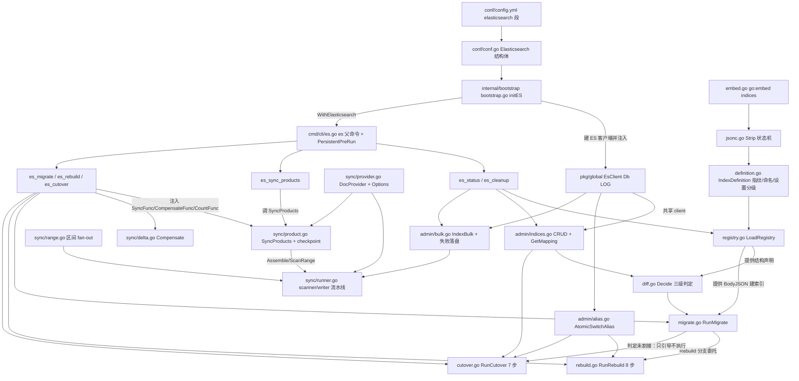
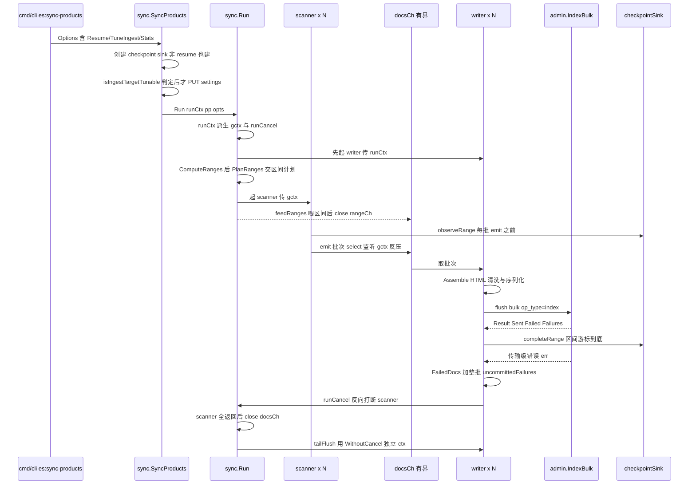
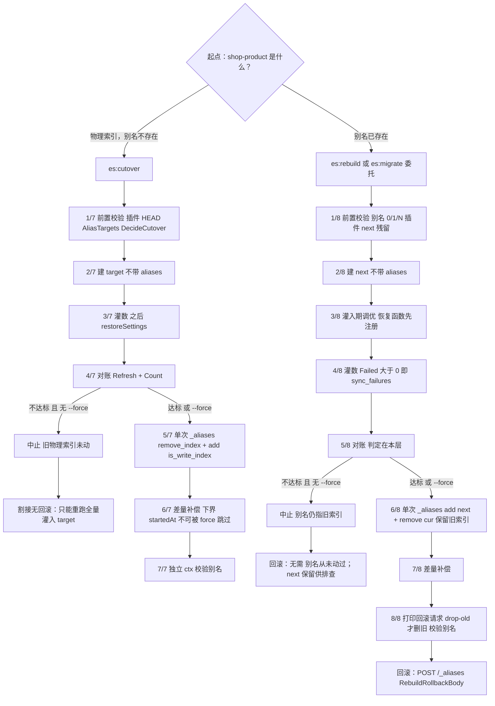

# ES 索引迁移与同步：设计说明与经验复盘

读者对象：需要消化本期 ES 设计、判断后续改进方向的研发与运维。

事实基准：本文所有路径、符号名、flag 名、默认值、行为描述都回读当前工作树源码逐一核对（`internal/es/**`、
`cmd/cli/es*.go`、`conf/conf.go` 的 elasticsearch 段、`internal/bootstrap/bootstrap.go`）。凡与早期方案
口头描述冲突之处，一律以代码为准，冲突清单见 §5.3。

规模：`internal/es` 非测试代码 7768 行，`cmd/cli/es*.go`（不含 _test）2268 行，ES 相关单测 192 个 Test 函数
（全部可在无 ES、无 MySQL 的环境跑通）。

---

## 1. 设计思路与取舍

### 1.1 与早期 PHP(artisan) 实现的关系

> 面向「要先会用」读者的命令全景、能力级 PHP 对照、ES 接口清单与设计模式索引，见同目录
> `es-usage-and-php-diff.md`；本节只讲原理层取舍，不重复那份正文。

PHP 版是一条 `php artisan` 命令打完的结构同步脚本。Go 版不是重写一遍，而是把 PHP 里三个「靠运气」的
环节换成代码：

| PHP 版做法 | Go 版对应 | 代码定位 |
|---|---|---|
| 改 mapping 后靠写入撞 `400` 异常来猜「结构差在哪」 | `Decide()` 只读探测 → `Noop / Inplace / Rebuild` 三级判定 | `internal/es/diff.go:142`、`internal/es/migrate.go:5` |
| 无条件 `close` 索引 → 改 settings → `open` | `InplacePutSettingsJSON()` 只下发动态项，明确不 close | `diff.go:198`、`diff.go:197` 注释「不要照搬 PHP 的无条件 close/open」 |
| 别名指向多个索引时取 `array_keys($a)[0]` | `>1` 直接报错中止，不猜首个 | `migrate.go:9`、`migrateOne` 三态分支 `migrate.go:148` |
| 单进程串行 `chunk` 灌数 | scanner/writer 双池 + 有界 channel 反压 | `sync/runner.go:72-78` |
| 结构变更 = 手工「删索引重灌」 | 蓝绿重建 + 单次 `_aliases` 原子切换，默认保留旧索引可回滚 | `rebuild.go:322`（8 步） |

Go 版多出来的约 7k 行代码，主要买到三样东西：

1. **并发提速**：区间 fan-out（`sync/range.go:28`，区间数 = `range-multiplier × concurrency`）+
   有界 `docsCh` 天然反压（`runner.go:78`），ES 慢时自动阻塞 MySQL 读，不需要手写限速。
2. **破坏性操作的安全护栏**：dry-run 审计层（`cutover.go:344-478` + `IsReadOnlyMethod:486`，写调用硬拒，
   并把读/写调用分别记成台账打印）；对账闸门置于切别名之前（`rebuild.go:514-538`）；`es:cleanup` 两道护栏
   （`cmd/cli/es_cleanup.go:142-193`）；非 TTY 且未带 `--yes` 时**零 ES 调用**退出（`es_cleanup.go:119-126`、`es_migrate.go:143-151`）。
3. **离线可测**：编排层只依赖窄接口 `SyncFunc / CompensateFunc / CountFunc / Cluster / RebuildTarget`
   （`cutover.go:71-145`、`rebuild.go:65-80`），具体实现由 CLI 装配层注入；因此 192 个 Test 不需要真实集群。

买贵了、或者买了但没用上的（诚实自评）：

- **`indices-dir` 外置这套双轨机制**：为「不发版改结构」付出三级优先级（`--indices-dir` > 配置
  `indices-dir` > 内嵌，`registry.go:112-121`）与一条纯靠人的纪律——「外置内容最终必须回写 jsonc，否则指纹
  对不上会反复触发迁移」（`indices/product.jsonc:14-15`）。这条纪律没有任何代码保证。
- **包级 var 注入**：`reconcileForTest`（`product.go:560`）、`setTotalFromBounds`、`boundsLookup`
  （`product.go:565/572`）、`putSettings/indexAliasesLookup/aliasIndexesLookup`（`product.go:684-692`）、
  `compensateScan/compensateBulk`（`delta.go:70/73`）。换来的是端到端用例能替掉真实依赖，代价是依赖关系
  从函数签名上消失、且并行跑测试（`t.Parallel`）时这些全局量会互相踩。
- **参数冗余**：`sync.Options` 有 21 个字段（`provider.go:162-192`），而 `--chunk-size / --concurrency /
  --bulk-size / --max-failures` 在 `es:sync-products / es:migrate / es:rebuild / es:cutover` 四条命令里各自
  重复声明一遍默认值（四处都是 `1000 / 4 / 3000 / 100`），改默认值要动四个文件。
- **配置面四项只接了一条路径**：`sync-concurrency / range-multiplier / bulk-max-mb / default-chunk-size` 现由 `es:sync-products` 读取（§1.3）；`es:rebuild / es:cutover / es:migrate` 的灌数参数仍是各自 flag 的硬编码默认值，改配置对它们无效。
- **两套对账实现并存**：编排层 `ReconcileCounts`（`cutover.go:724`）与 sync 层 `reconcile`
  （`product.go:479`）语义相同、代码各一份；负容差的解释只在 `ReconcileCounts` 一处拥有
  （`rebuild.go:525-526` 注释把「两层各写一套正是审查报出的分歧源」钉死了）。

### 1.2 分层设计与切分理由

| 层 | 位置 | 职责 | 为什么切在这里 |
|---|---|---|---|
| 定义层 | `indices/*.jsonc`、`embed.go`、`jsonc.go`、`definition.go`、`registry.go` | 结构唯一事实源；JSONC 去注释；规范化 + sha256 指纹；装载优先级 | 结构变更 = 代码变更：随二进制 `go:embed` 发布（`embed.go:9-17`），diff 才有可比对象 |
| 管理层 | `admin/indices.go`、`admin/alias.go`、`admin/bulk.go` | ES 原语的薄封装：CRUD、别名原子操作、bulk 与失败落盘 | 唯一直接碰 `elastic.Client` 的地方；把「单请求原子」「绕开存在性缓存」这类坑封在一处 |
| 同步层 | `sync/provider.go`、`range.go`、`runner.go`、`product.go`、`delta.go` | scanner → docsCh → writer 三段流水线；checkpoint；失败落盘；差量补偿 | 与 ES 结构解耦：只认 `DocProvider` 接口，加一类索引不碰流水线 |
| 编排层 | `migrate.go`、`rebuild.go`、`cutover.go`、`diff.go` | 决定「做什么、按什么顺序、何时中止」；持有对账判定权 | 破坏性顺序与判定权必须集中，绝不能下沉到灌数层（`rebuild.go:82-89`） |
| CLI 装配层 | `cmd/cli/es.go` + 6 个 `es_*.go` | 解析 flag、注入窄接口实现、交互确认、打印结论 | flag 与人是唯一「不可测」的部分，把它压到最薄 |

关键切分决策：

- **`es` 父命令独享 ES 初始化**：`cmd/cli/es.go` 的 `PersistentPreRun` 才调
  `bootstrap.BootstrapWith(configPath, bootstrap.WithElasticsearch())`，其余 CLI 命令不建 ES 连接，
  避免「跑个队列命令顺手连了个不该连的集群」。
- **灌数层只灌、不判定**：装配层给内层灌数的 `Tolerance` 固定填哨兵
  `es.IngestToleranceIgnore = math.MaxInt64`（`rebuild.go:89`），三条路径都已注入：`es_rebuild.go:244`、
  `es_cutover.go:272`、`es_migrate.go:243`（经纯函数 `migrateIngestOptions`），把「达标与否」留在编排层真实回读之后。
- **编排层不 import sync 的内部类型**：`rebuild.go:23-25` 明确「sync 签名再变只冲击 CLI 装配层」。

### 1.3 配置面逐字段（`conf/config.yml:45-60` ↔ `conf/conf.go:86-101`）

| 字段（默认值） | 实际读取方 | 作用 / 调大调小的后果 |
|---|---|---|
| `enabled: true` | `bootstrap.initES` + 6 个 CLI 的前置检查（如 `es_status.go:189`） | false 时 `initES` 只记日志返回；`es:*` 命令直接拒绝执行。 |
| `hosts` | `initES`（`bootstrap.go` 内 `es.InitClientWithOptions(...)`） | 节点列表；填错表现为所有命令在第一个只读调用处失败。 |
| `username` / `password` | `initES` | 无认证集群留空；填错时 `es:status` 打印 hosts 便于定位（`es_status.go:205`）。 |
| `indices-dir: ''` | **`registry.go:117`（全仓唯一读取点）** | 外置声明目录，空 → 内嵌。指定了但目录为空会**报错而非静默回落内嵌**（`registry.go:101-104`，「属于配置事故」）。 |
| `bulk-workers: 10`、`bulk-action-size: 1000`、`bulk-request-size: 5242880`、`flush-interval: 5` | `initES` 组装 `es.WithBulk` | 服务于共享库 BulkProcessor（Kafka 消费侧那条路）。本期 CLI 灌数**不走它**，走 `admin.IndexBulk` 自己切块。`flush-interval` 单位是秒，代码侧必须 `× time.Second`（`conf.go:95` 注释）——`WithBulk` 不显式传就会退化成 1ns ticker 打满 CPU（`bootstrap.go` 注释钉死）。 |
| `query-log-enable: false` | `initES` → `es.WithQueryLogEnable` | 打开后 DSL 落到 zap 的 `es_dsl` 模块；生产高 QPS 别开。 |
| `sync-concurrency: 4` | ✅ **`es:sync-products` 已接线**：`ResolveSyncParams`（`provider.go:265`）← `es_sync_products.go:189-202`（字段 `conf.go:97`） | 优先级「显式 `--concurrency` > 配置 > 常量 `defaultConcurrency`（`provider.go:205`）；只影响这一条灌数路径。 |
| `range-multiplier: 4` | ✅ 同上（`conf.go:98`） | 区间数 K = 该值 × 并发数；`--range-multiplier` 显式传入时优先。 |
| `bulk-max-mb: 10` | ✅ 同上（`conf.go:99`） | 单个 bulk 体积上限；配置或 flag 填 `0` 都是合法值，语义为「交 `admin.DefaultBulkMaxBytes = 10MB`」（`bulk.go:42`）。 |
| `default-chunk-size: 1000` | ✅ 同上（`conf.go:100`，Go 字段名 `DefaultChunk`） | 分块批大小，回落常量 `defaultChunkSize`（`provider.go:204`）。 |

> 接线口径（`provider.go:197-202` 注释）：三级优先级由 `ResolveSyncParams`（`:265`）单点裁决，「是否显式传入」看
> cobra `Flag.Changed`（`es_sync_products.go:191-194`）；配置值 `0` 视为未提供并静默回落内置默认，负值与显式 flag
> 的非法值都经 `clampInt`（`:213`）收敛并追加告警（`es_sync_products.go:203-205` 落 stderr），绝不静默采纳。
> **边界**：目前只有 `es:sync-products` 接线；`es:rebuild` / `es:cutover` / `es:migrate` 要用同一套配置，需在各自
> 装配层再调一次 `ResolveSyncParams`——现在没有，别误以为全局生效。

---

## 2. 六个核心功能点

每点固定四小节：动机 / 实现 / 关键约束与坑 / 后续可改进方向。

### 2.1 蓝绿重建 + 别名原子切换

**动机（不做会怎样）**：商品索引有 15 个主分片（`indices/product.jsonc` settings），mapping 的静态项
（分片数、`index.sort.field`、`store.preload`）创建后不可改，只能重建。如果在生产别名上原地重建，
写入与查询会在整个重建期间（小时级）面对一个半残索引；把「建新 → 灌数 → 对账 → 一次切换」拆开，
任何一步失败线上读都不受影响，且旧索引原样保留，可把别名再原子切回去。

**实现**（`rebuild.go:322` `RunRebuild`，8 步与 CLI 打印的 `[n/8]` 对齐）：

1. `[1/8]` 前置校验（`rebuild.go:371`）：插件缺失即中止；别名指向 0/1/N 分支；`res.Cur == next` 免重建；
   next 已存在 → 报「请先 `es:cleanup` 删除该残留」。
2. `[2/8]` 新建 next（`rebuild.go:452`）：`CreateIndex` **不带 aliases**（`admin.Create` 不注入，
   `indices.go:44`），避免半成品被读到。
3. `[3/8]` 灌入期调优（`rebuild.go:496`）：`refresh_interval=-1`、`number_of_replicas=0`，
   且「注册恢复函数先于变更」，回滚用 `context.WithoutCancel` 派生的独立 ctx。
4. `[4/8]` 灌数（`rebuild.go:503-512`）：先 `restoreSettings()` 再判 `summary.Failed > 0` → `sync_failures`。
5. `[5/8]` 对账（`rebuild.go:514-538`）：`Refresh` + `Count` 真实回读，`ReconcileCounts` 判达标；
   不达标且无 `--force` 即中止，别名仍指向旧索引。
6. `[6/8]` 单次 `_aliases`（`rebuild.go:540-548`）：`SwitchAliasKeepOld`。
7. `[7/8]` 差量补偿（`rebuild.go:550-573`），详见 §2.5。
8. `[8/8]` 保留旧索引 + 打印回滚请求体；仅 `--drop-old` 才 `DeleteIndex`；随后独立 ctx 校验别名。

切换为什么必须在**一次**请求里：`rebuild.go:17-18` 记着实测结论——把 `remove cur` 与 `add next` 拆成两次
`_aliases`，在第一步之后再往别名名写文档会返回 **201**，因为 ES 会**自动创建一个与别名同名的空索引**
接走写入。此时读走的是旧索引、写进的是一个谁都不知道的空索引，比割接失败更彻底地丢数据。因此：

- rebuild 走 `admin.AtomicSwitchAlias`（`alias.go:107`），内部只发一个 `svc.Do()`，天然单请求；
  提交前断言 `removeIndexes` 当前确实持有 alias，否则「别名指向异常，已中止切换」。
- cutover **刻意不用**它（`cutover.go:263` 注释）：割接起点 `shop-product` 是物理索引名，
  `AliasIndexes("shop-product")` 恒空，那条断言必然误报；于是自己组
  `NewAliasRemoveIndexAction(alias)` + `NewAliasAddAction(alias).Index(target).IsWriteIndex(true)`
  在同一次 `Do()` 里下发。
- 请求体是纯函数，便于逐字比对真机样本：`RebuildSwitchBody`（`rebuild.go:172`，先 add 后 remove）、
  `RebuildRollbackBody`（`rebuild.go:192`）、`CutoverAliasBody`（`cutover.go:614`，固定 remove_index → add）。

`_meta.schema_version` 的作用：物理索引名由它派生（`definition.go:221 IndexName`、`:226 NextVersionName`，
分隔符常量 `VersionSeparator="_v"` 在 `definition.go:53`），下一代索引名 = `<alias>_v<N+1>`
（同时写在 `product.jsonc` 的 `_meta.next_version_rule`）。回读时优先信 `_meta`，拿不到才回退索引名尾缀，
两者都拿不到就返回 `unknown` 绝不猜（`ResolveSchemaVersion`，`cutover.go:774`）。

**关键约束与坑**

- **物理索引名与别名绝对互斥**，且 `_close` 不解除：占用同名位置时，建索引报
  `400 invalid_index_name_exception: already exists as alias`，起别名报 `400 invalid_alias_name_exception`。
  这条互斥是好事——`es:status` 只靠 `GET /_cat/aliases` + `HEAD /<name>` 两个只读请求就能把名字判成
  `alias / physical_index / missing`（`es_status.go:328-349`）。
- `is_write_index` 必须与 `remove_index` 同请求下发：两个写索引时 ES 8.2.2 返回
  `500 illegal_state_exception`（`cutover.go:263` 附近注释）。
- 单索引时 `_cat/aliases` 的 `is_write_index` 列是 `"-"`，含义是「未显式设置，隐式即写索引」，
  不能当失败：`writeIndexEffective`（`cutover.go:671`）、CLI 展示同口径（`es_status.go:553-558`）。
- `--force` 只放松第 5 步「切不切」的闸门，不放松任何收尾动作；判定权在本层，内层灌数拿到的是哨兵容差。
- 切换失败不自动删任何索引：`rebuild.go:543-546` 只标 `AbortedStep="switch"` 并把 next 记成 orphan，
  因为此刻别名「可能动了也可能没动」，自动删会把判断权从人手里抢走。

**后续可改进**

- 切换后立刻用独立 ctx 读回 `ListAliasRows` 校验已有，但**失败路径没有对称的读回**：`switch` 失败时
  建议顺手打印一次 `_aliases` 现状，省掉人肉排查「到底切了没」。
- rebuild / cutover 各一份请求体构造函数，`switchAdd/switchRemove` 结构体也各一份，可下沉成
  `admin` 的 action builder 单测覆盖。
- `--force` 目前不加二次确认，可与 `cutoverStdinIsInteractive` 一样做一次显式确认。

### 2.2 `dynamic: strict`

**动机**：商品文档结构在三个仓库各有一份 `ProductIndex` struct（见 §3.4）。如果 mapping 允许动态字段，
某个仓库多写一个字段的结果是「ES 里悄悄多出一个没分词器、没索引选项的字段」，查询行为随写入顺序漂移，
且没人知道。`strict` 把这种漂移从「静默污染」变成「当条写入立刻失败并留下证据」。

**实现**：声明在 `indices/product.jsonc:140-145`（`"dynamic": "strict"`）。失败形态必须搞清：

- bulk 请求整体返回 **200**，被拒的是**那一条 item**（`status: 400`，
  `strict_dynamic_mapping_exception`）。因此绝不能只看 HTTP 码，必须逐 item 判错——
  `admin.doBulk`（`bulk.go:219`，扫描在 `:246-261`）在 `resp.Errors` 为真时逐条扫 `resp.Items`，并用 `seen` 去重计数。
- 分类在 `classifyBulkItem`（`bulk.go:296`）：只有 429/503 与 3 个可重试 type 走退避；
  结构类失败（含 strict）**不重试，直接进失败明细落盘**。
- `_source.excludes`（`product.jsonc:146-155`）排除 `store_name/store_info/description/keyword` 四个大文本。
  它与 strict 是配合关系：字段照旧声明、照旧参与倒排，只是不进 `_source`，省空间的同时把
  「回查原值」这条路指向 DB。`doc_assemble.go:86` 的注释因此明确「`_source` 已 excludes 掉 description，
  写入期在 Go 侧去 HTML 标签、截断到 `MaxDescriptionRunes` 不丢回查」。

**关键约束与坑**

- **变更顺序有硬约束**：改字段必须「先 `es:migrate` 让结构生效，再发布产出该字段的代码」，反向顺序会让
  所有写入命中 strict 而整批失败（`product.jsonc:9-11` 变更纪律第 1 条）。
- struct 的 json tag 集合与 mapping 的 `properties` key 集合必须**严格互等**；唯一豁免是
  `_meta.copy_to_only_fields: ["desc"]`——`desc` 是 `copy_to` 的汇聚目标，只存在于 mapping、
  文档里不得出现（`doc_assemble.go:47` `BuildIndexDoc` 不产出 `desc`）。这条互等由
  `internal/es/doc_test.go` 双向断言钉住。
- strict + `_source.excludes` 合起来造成一条必须知道的后果：**失败样本无法从 ES 回查**，
  所以 `admin.Failure.Doc` 必须自带完整快照（`bulk.go:64` 注释），落盘的 jsonl 是唯一现场证据。
- 这条约束正是「失败落盘 + 重放」（§2.4）存在的直接原因：结构类失败可预期、成批出现、且不能因为
  100 条脏数据让小时级的全量任务整体失败。

**后续可改进**

- 把「struct tag ↔ mapping key」互等校验从单测提到 CI 静态检查（现在靠人记得跑测试）。
- strict 失败目前落 jsonl 后靠人读文件；可以在任务结束时按 `type` 聚合打印一份 top 失败原因。

### 2.3 断点续传（checkpoint）

**动机**：全量灌数是小时级。中断后不续传就得从头重灌，除了时间，还意味着重复扫描 MySQL 全表。

**实现**：

- 落盘位置：`<checkpointBaseDir>/<sanitize(target)>.checkpoint.json`，基目录默认
  `runtime/es_sync`（`product.go:44`，包级 var 可被单测注入临时目录）；路径生成 `checkpointPath`
  （`product.go:1033`）。
- 字段：`checkpoint{Target, StartedAt, Total, LastID}`，json tag
  `target/started_at/total/last_id`（`product.go:874-879`）。
- **新起路径也必须落盘**：sink 的创建在 `opts.Resume` 分支之外（`product.go:281-297`），
  非 resume 走 `newCheckpointSink`（`:296`），resume 命中文件才走 `restoreCheckpointSink`（`:292`，
  保留原 `StartedAt/Total`），resume 但文件不存在则打印「将从头全量执行」并新建 sink（`:288-289`）。
  早期版本只在 `opts.Resume` 分支里创建 sink，导致首次全量永远不落盘、`--resume` 整条路径不可达（§5.1）。
- **`LastID` 不由各 scanner 直接写**，这是本轮修掉的 BLOCKER。默认 `--concurrency=4`、
  `--range-multiplier=4` 时本次有 16 个区间并行推进，完成顺序与 id 顺序无关：谁先跑完谁写 `LastID`
  会得到一个**非单调**的游标，续传时 `id > LastID` 会**静默跳过尚未扫完的低 id 区间**——丢数据且无任何报错。
  现在的正确规则是「按区间记账，游标只推到最小连续覆盖右边界」：
  - `Run` 在启动 scanner **之前**通过可选接口 `RangePlanCarrier` 把本次区间计划交给 provider
    （`runner.go:124-128`，接口定义 `provider.go:98`，实现 `product.go:186 PlanRanges`）；
  - `planRanges`（`product.go:925`）排序后只保留从第一个区间开始的**无空洞连续前缀**，遇空洞即截断；
  - 每批从 DB 读出后、**emit 之前**调 `observeRange(r, batch[last].Id)`（`product.go:150-152`，
    注释说明 emit 可能因 writer 失败永不返回，不记就会重灌整批）；
  - 区间游标正常走到底才 `completeRange`（`markRangeDone`，`product.go:177-182`：`err != nil` 不登记，
    「宁可重扫不可漏扫」）；
  - `recordRange`（`product.go:962`）在锁内更新 `prog[r.Lo]`，用 `frontierLocked`（`product.go:1013`）
    算出新游标，`next <= cp.LastID` 时**不落盘也不回退**；
  - `frontierLocked` 的规则：已 done 的区间把边界推到 `r.Hi` 并继续；第一个「进行中」区间把边界推到
    其 `lastID`（须满足 `r.Lo < lastID <= r.Hi`）后停止；遇到尚未开始的区间立即停止；plan 为空返回 0。
- 续传侧：`applyResumeState`（`product.go:539`）在 `LastID > 0` 时把 `minExclusiveID` 设为 `LastID`
  （进入 `filter` 的 `id > ?` 条件，`product.go:110-112`），并强制 `Concurrency=1、RangeMultiplier=1`
  —— 本轮最小改动，不在续传路径上放开并发。
- 收尾纪律：`Total` 只在非 resume 时由 `setTotalFromBounds` 写（`product.go:298-303`，避免用带下界的
  Bounds 覆盖首次全量口径）；checkpoint 在**全部成功含对账之后**才删（`product.go:378`），
  局部补数（`--ids/--since`）直接清掉（`product.go:363`），失败路径一律保留（`product.go:352/375`）。

**关键约束与坑**

- `--resume` 的差量补偿下界必须是**任务首次启动时刻**，不是恢复时刻：`StartedAt` 随文件一起恢复
  （`restoreCheckpointSink`，`product.go:918-920` 注释把这条口径标成关键），写错会漏掉中断窗口内的变更。
- resume 的对账不跳过，且要临时清掉 `minExclusiveID` 取全量口径（`execResumeReconcile`，
  `product.go:550-556`，save/restore 模式被单测直接保护）——全量口径对账正是用来暴露「丢了一段」的。
- 落盘失败只打 stderr、不改任务结果（`product.go:990-1003`）：checkpoint 是加速器不是真相源，
  不能因为写不进临时盘把灌数任务判失败。
- `checkpointPath` 按 target 命名，因此割接不做续传：`es_cutover.go:276` 显式 `Resume: false`
  并注释「checkpoint 按 target 命名，割接是一次性动作」。

**后续可改进**

- `prog`（哪些区间已 done）不落盘：进程重启后 plan 重建、进度从零记，续传会把已完成的区间**重扫一遍**
  （幂等，所以只是慢）。把 done 集合序列化进 checkpoint 即可省掉这段。
- 同一 target 上并行跑两个 CLI 会互踩 checkpoint 文件（无锁、无 pid 校验）。
- 续传路径仍强制单并发，可以改成「plan 落盘 + 允许并发」，让续传也吃到并行收益。

### 2.4 失败落盘与重放

**动机**：strict 模式下结构类失败必然成批出现。既不能让 100 条脏数据废掉一次小时级全量，
也不能把它们静默丢掉——「丢掉」在本期真实发生过（§5.1 的必修②）。

**实现**：两类失败形态完全不同，必须分开对待。

| 失败形态 | 判定位置 | 是否落 jsonl | 计数去处 |
|---|---|---|---|
| item 级失败（某条被拒：strict 400、mapping 冲突、退避耗尽） | `doBulk` 逐 item 扫 `resp.Items`（`bulk.go:246-261`），`classifyBulkItem`（`bulk.go:296`）分可重试/结构类 | **落**：`dumpFailures`（`bulk.go:411`），由 `finishBulkResult` 在 `result.Failed > 0 && writeFailures` 时触发（`bulk.go:208-214`，`IndexBulk` 两个出口 `:139`/`:170`） | `BulkResult.Failed/Sent/Failures` |
| 整批请求级失败（HTTP/传输级错误，ES 未确认任何一条） | `IndexBulk` 直接 `return nil, err`（`bulk.go:149-151`） | **不落**（`admin` 层拿不到可确认的 item 列表） | 由 `runWriter.flush` 兜住：`FailedDocs += len(docs)`，并用 `uncommittedFailures`（`runner.go:338-355`）逐条生成 `Type: "bulk_request_failed"` 的明细并入 `stats.Failures` |

- item 级失败落盘的条件与后果：`IndexBulk` 收尾统一调 `finishBulkResult`（`bulk.go:208`），
  `Failed = len(Failures)`，`Failed > 0 && writeFailures` 才 `dumpFailures`；空 `_id` 的文档在投递前就被
  `splitByID`（`bulk.go:177`）拆出来并预置成 `Failures`（`bulk.go:133-134`），因此也走同一份落盘路径——
  连「整批都没有 `_id`」这种零请求场景都不会退化成假成功（`bulk.go:138-140`）。
- 退避耗尽 / ctx 取消路径另有 `giveUpFailures(Type: "retry_exhausted")`（`bulk.go:309`，调用点 `:160`/`:165`）。
- 文件命名与位置：`failed_<sanitize(target)>_20060102_150405.jsonl`
  （`failureFileName`，`bulk.go:373`；`sanitizeTarget` 用 `unsafeFileRe` 洗掉路径字符，`bulk.go:361-364`），
  目录默认 `runtime/es_sync`（`defaultFailureDir`，`bulk.go:39`），
  可用 `--failure-dir` 覆盖（CLI flag → `sync.Options.FailureDir` → `admin.WithFailureDir`，
  `runner.go:388`）。写入用 `O_APPEND|O_CREATE` + 自动 `MkdirAll`（`bulk.go:411-427`）。
  每行是一条 `Failure`，`Doc` 字段自带文档快照；`encodeFailure`（`bulk.go:389`）在快照无法序列化时
  降级为丢 `Doc` 但保留 ID/status/type，绝不因为一行写不出而丢整份明细。
- 落盘本身失败必须冒泡：`finishBulkResult` 返回「bulk 完成但 %d 条失败，且失败明细落盘失败」的合并错误
  （`bulk.go:212`），不给运维一个「失败已记录」的假象。
- `--retry-failed=<path>`：`SyncProducts` 在最前面短路（`product.go:268-270`），走 `runRetryFailed`
  （`product.go:383`）→ `admin.ReadFailures`（`bulk.go:456`，单行缓冲放宽到 8MB，`:467`）→
  `parseFailureLine`（`bulk.go:443`，`Delete: rec.Op == OpDelete` 在 `:451`）→ 按 `--bulk-size` 切块重投（串行，不启流水线）。
  `ReadFailures` 会**跳过 `ID==""` 的明细并计数告警**（`bulk.go:471-478`、`:486-489`）：这类样本落盘只为可观测，
  无法幂等重投，绝不能因为一行脏数据让整份失败文件读不动。
- 重放幂等：写入固定 `op_type=index`（`bulk.go:33-34` 常量、`defaultWriter` 注释 `runner.go:382-392`
  「绝不改用 create」）。`create` 对已存在 `_id` 返回 409，重放同一条必然制造一批新失败。

**关键约束与坑**

- 曾有 P0：`runRetryFailed` 里 `stats := &SyncStats{}` 把 `opts.Stats` 丢弃，CLI 进度条/报表拿的是
  注入容器，于是重放后「扫描 0 / 写入 0」——不是没写，是报表恒 0。现为
  `stats := opts.Stats; if stats == nil { ... }`（`product.go:388-392`）。
- 「bulk 整体 200」这个陷阱无处不在：`resp.Errors` 为 true 时 HTTP 仍是 200，
  任何「看状态码判成功」的实现都会把结构失败读成成功。
- 重放不再走反压流水线，所以 `--concurrency` 对它无意义；但它同样受 `--max-failures` 约束
  （`product.go:418-421`），脏数据没修就重放会很快撞阈值。
- 重放再失败会生成**新的时间戳文件**，不会覆盖原文件；同秒内启动两次任务则文件名相同
  （`O_APPEND` 下不会截断，但两份明细会混在一起）。
- `stats.Failures` 是内存聚合，供诊断；除 `--json` 类输出外 CLI 并不打印它，落盘的只有 item 级失败。

**后续可改进**

- 请求级失败（整批传输错误）目前只计数、不落 jsonl；`uncommittedFailures` 已把它变成逐条明细，
  只差在 sync 收尾调一次 `dumpFailures`，就能让「重放」覆盖这一类。
- `--retry-failed` 建议支持目录（一次跑完当天所有失败文件）与 dry-run。
- 早期版本空 `_id` 文档被 `continue` 静默丢弃（既不报错也不计 Failed），现已由 `splitByID` 转成
  `Type: "missing_id"` 的失败明细（`bulk.go:177`，注释「过滤与计数必须出自同一个函数：一旦分家就会出现
  『过滤了但没记账』的静默丢数据」）。这一类历史上就在「记账未修」清单里，本轮已修（见 §5.3）。

### 2.5 切换窗口内的差量补偿

**动机**：全量灌数跑数小时内 MySQL 一直在变。target 里灌的是「`startedAt` 那一刻的样子」，
如果不补一轮，切换完成后这批变更永久消失——rebuild 里旧索引还在（可回滚，但读的是旧数据），
cutover 里旧索引已被 `remove_index` 连数据一起摘走，**再也回不来**（`cutover.go:941-943` 注释）。

**实现**：

- 窗口起点：`startedAt := time.Now()` 在编排最开头固化（`cutover.go:980`，`RunRebuild` 同源同语义），
  注释写明「绝不取切换时刻——那会把灌数窗口内的变更静默漏掉」。
- 回调契约：`CompensateFunc(ctx, target, since) (CompensateSummary, error)`（`rebuild.go:65`）。
  返回值必须同时带统计与 error——`error` 只表达「没跑完」，`Stats.Failed` 表达「跑完但有文档没写进去」，
  合并成一个 error 就会把结构类失败吞成成功（`rebuild.go:44-47/62-64` 注释即本轮修复的说明）。
- 真实 SQL 形态（`delta.go:121 compensateScope`）：

  ```go
  db.Model(&models.StoreProduct{}).Unscoped().Select(compensateColumns).
      Where("update_time >= ?", since).Where("id > ?", lastID).Order("id ASC").Limit(chunkSize)
  ```

  三个要点：**必须 `Unscoped()`**，否则 GORM 软删过滤会把「已被逻辑删除的行」挡在结果外，
  补偿就永远看不到「该从索引里删掉」的文档；**不加 `is_show`/`is_del` 过滤**，因为不合格行需要
  被读出来并显式发 delete；`Select` 里带上 `is_show/is_del` 只用于判定、不构成过滤
  （`compensateColumns`，`delta.go:134`；口径差异三条写在 `delta.go:10-16`）。
- 逐行判定走同一个 `es.BuildIndexDoc`（`delta.go:148 compensateDocs`）：不合格 →
  `admin.Doc{Delete:true}`，`Id==0` 的行跳过。写入同样 `op_type=index`，所以补偿整体幂等、可用同一
  `since` 重跑（CLI 提示语 `es_rebuild.go:328-329`）。
- 串行 id 游标，`Stats{Scanned,Indexed,Deleted,Failed,Batches}` 用普通整型即可
  （`delta.go:38`，单 goroutine 顺序提交）；取消时也要提交尾部缓冲（`delta.go:178 Compensate`）。
- 装配点：`newRebuildCompensateFunc`（`es_rebuild.go:269-283`）、`newCutoverCompensateFunc`
  （`es_cutover.go:296-305`），两处都把 `st.Failed` 原样带出。
- 消费点：rebuild 第 7 步（`rebuild.go:551-573`）区分三种如实失败——回调为 nil、`cerr`、
  `cstats.Failed > 0`（`AbortedStep="compensate_failures"`）；cutover 第 6 步（`cutover.go:1200-1226`）
  同构，并且额外在 dry-run 下硬拒补偿写（`cutover.go:1204-1208`），不依赖「预演分支一定在第 5 步之前返回」
  这条约定。

**关键约束与坑**

- 补偿失败**不回滚切换**：线上已在读新索引，回滚的代价大于补偿一次脏数据的代价；因此报错文案必须给出
  「补偿幂等，可用同一 `since` 重跑」的可执行指令（`rebuild.go:563/570`）。
- `--force` 绝不能跳过补偿：`es_cutover.go:90` 的 flag 描述就写着「不能跳过切换后的差量补偿」，
  实现上第 6 步在闸门之外无条件执行（`cutover.go:1196-1199` 注释）。
- 补偿是 `update_time >= since` 的全表扫描，`update_time` 无索引时会退化成大扫描；
  窗口拖得越久补偿越贵，这与「灌数别跑太久」是同一条运维纪律的两面。

**后续可改进**

- 固定一轮补偿。极端场景（灌数 3 小时 + 窗口内变更 10 万行）可以做成「按 `update_time` 分桶补到
  追平为止」，直到某轮扫描行数低于阈值。
- `CompensateSummary` 与 `SyncSummary` 是两个结构体（有意为之，避免跨层耦合），但字段高度重合，
  可以考虑抽一个 `stats` 值类型。

### 2.6 同名物理索引割接为别名（cutover 特有风险）

**动机**：线上 `shop-product` 当年是直接建的**物理索引**，而本期所有安全机制都建立在「读别名、写别名、
物理名带版本尾缀」之上。割接就是把这个历史遗留的物理索引换成同名别名——本期唯一**不可回滚**的一步。

**为什么最危险**：ES 中物理索引名与别名绝对互斥（§2.1），所以「`shop-product` 既是物理索引又想做别名」
不存在中间态；而且别名一旦切过去，旧数据就同时只能有一份。

**唯一安全序列**（`RunCutover`，`cutover.go:948`，7 步，CLI 打印 `[n/7]`）：

1. `[1/7]` 前置校验（`cutover.go:997-1055`）：插件缺失即中止；`HEAD /<alias>` 命中 + `AliasTargets`
   把名字定性成三态，`DecideCutover`（`cutover.go:536`）给出 `AlreadyCutover / TargetOccupied /
   MissingSource / ProceedCutover`；判定顺序刻意把「幂等已完成」放在「目标被占」之前。
2. `[2/7]` 按声明建 `target = shop-product_v1`（不带 aliases）。
3. `[3/7]` 灌数（可选提速）；先 `restoreSettings()` 再判 `summary.Failed > 0` → `sync_failures`。
4. `[4/7]` **对账先于切换**（`cutover.go:1155-1186`）：不达标即中止，旧物理索引未动、线上读不受影响；
   `--force` 才继续。
5. `[5/7]` 单次 `POST /_aliases`：`remove_index shop-product` + `add shop-product_v1 (is_write_index)`
   （`SwitchAlias`，`cutover.go:263`；请求体纯函数 `CutoverAliasBody:614`）。
6. `[6/7]` 差量补偿（§2.5），必跑、不可被 `--force` 跳过。
7. `[7/7]` 用独立 ctx 校验别名指向（`VerifyCutoverTarget`，`cutover.go:635`）。

对账口径的如实记账（写在代码注释里，`cutover.go:1156-1159`，不粉饰）：`dbExpected` 取自灌数**之前**、
`esCount` 是灌数**之后**的 `_count`，两者本就不是同一时点，窗口内的新增/下架会造出「假失败」；
因此才给 `--force` 这条退路，语义与 `es:rebuild` 完全对齐。

`es:migrate` 首建顺序（本期已修）：`migrateFirstCreate`（`migrate.go:317`）现在与 `es:rebuild` 共用同一条安全序列——
建索引的 body 用 `def.BodyJSON()`（`migrate.go:327`，**不带 `aliases`**，读写都触达不到它）→ 灌全量 →
`Refresh + Count` → `ReconcileCounts` 对账（`migrate.go:378`，与蓝绿同一口径，含「负容差 = 永不可达标」）→
达标后才**单次** `POST /_aliases` 纯 `add` 挂别名（`migrate.go:335` 复用 `RebuildSwitchBody(alias, next, "")`，
`:389` 执行）。不达标则索引存在但**绝不挂别名**，报错点名残留索引名并给两条后续动作（`migrate.go:382-384`：
删残留后重跑 migrate，或保留 + 手工挂别名后改用 rebuild）。旧的 `firstCreateBody` 已删除。

集群健康恒 yellow 属正常：本期目标是本地 docker **单节点**，`number_of_replicas: 1` 的副本永远分配不上，
加上灌入期临时 `replicas=0`（`rebuild.go:496`、`cutover.go:1107` 都注明「呈 yellow 属预期」）。
`es:status` 因此只把 yellow 记录进报表、不判故障（`es_status.go:472-474`）。判「红」才需要人工介入。

**关键约束与坑**

- 割接没有「保留旧索引可回滚」这条路，dry-run 文案就明确写出：回滚只能重跑 MySQL 全量灌入目标索引
  （`cutover.go:1086-1087`）。
- `es:cleanup` 的两道护栏就是为这一步兜底（`cmd/cli/es_cleanup.go`）：护栏一——版本红线加别名持有：索引名
  必须带版本尾缀才可能是候选（`cleanupVersionRe`，`:41`；扫描模式 `:176-177`，`--index` 单索引模式同样硬拒，
  `checkSingleIndexTarget:242-248`），而 `_cat/aliases` 构造的 `heldByAlias` 里**任何被别名持有的索引永不删**
  （`:143-150`，单索引判定 `:248`）；护栏二——创建时间必须早于 `now - --older-than`（默认 168h）：
  `:153` 算 cutoff，`:185-189` 走 `passesAgeGate:259`，`creation.date` 缺失时 fail-closed 跳过；
  无版本尾缀的 `shop-product` 一律不碰；`--list-only` 默认 true（零写操作）；删除确认在**任何 ES 调用之前**
  （`:119-126`）。
- 版本尾缀正则本仓库有三份：`admin/alias.go:23` 的 `versionSuffixRe`、`cutover.go:738` 的 `targetVersionRe`、
  `es_cleanup.go:41` 的 `cleanupVersionRe` —— 本轮审查后三者已统一为 `_(?:v)?(\d+)$`（同时认 `_v12` 与 `_12`），
  此前 `cleanup` 那份只认 `_v\d+$`、与自己的注释不一致，是一处真实语义漂移（已修，见 §5.3）。

**后续可改进**

- ~~`migrateFirstCreate` 改成「先建 `shop-product_v1`（无别名）→ 灌数 → 对账 → 单次 `_aliases`」~~ **本期已按此实现**
  （见本节上方与 `migrate.go:317`）；`es:migrate` 首建已做到「过闸门之后才暴露给线上读」。
- 割接前建议增加「旧物理索引 doc 数 vs DB 期望」的预检报表，让运维在切之前就看见窗口风险有多大。

---

## 3. 代码关联图

### 3.1 分层依赖



边的意图标注（图上无法逐字写清的补充）：

| 边 | 调用意图 |
|---|---|
| `bootstrap → admin/client` | `initES` 只建共享库客户端（`global.EsClient`），`admin` 各函数从它取 `*elastic.Client`，并绕开共享库的存在性缓存（`admin/indices.go:27 Exists`） |
| `registry → definition` | `LoadRegistry` 产出 `IndexDefinition`，是编排层唯一能拿到「声明侧结构 + 指纹 + 别名」的入口 |
| `migrate → rebuild` | `delegateRebuild`（`migrate.go:285`）用裸 `opts.Target` 调 `RunRebuild`，不套第二层审计，避免 dry-run 台账重复计数 |
| `migrate → cutover` | 方向上的约定：`migrateCutoverRequired`（`migrate.go:387`）只中止并提示去跑 `es:cutover`，`es:migrate` 永不下发 `remove_index` |
| `CLI → sync / 编排` | 装配层把 `sync.SyncProducts / sync.Compensate / es.ProductDocCount` 包成窄接口回调注入编排层，编排层不 import `sync` 的内部类型（`rebuild.go:23-25`） |

### 3.2 全量同步数据流（含 ctx 边界）



**ctx 边界（本期最贵的一个教训）**：

- `runCtx`（`runner.go:72`）：只被 `runCancel()` 显式取消（writer 失败、超阈值、上游超时/信号）。
  **writer 必须挂它**——`errgroup` 会在所有 scanner 正常返回后自动 cancel `gctx`，把在途 bulk 全杀掉。
- `gctx`（`runner.go:74`）：scanner 侧使用，任一 scanner 返错即级联取消；emit 的 `select` 监听它
  （`runner.go:149-156`），保证 docsCh 满时取消能真正打断发送侧。
- 结论：**长生命周期消费者绝不能拿 `gctx`**。这条已写进代码注释（`runner.go:113-115`、`runner.go:268-269`
  「第六轮 P0 钉过的教训」）。
- 第三类 ctx：收尾专用 `context.WithTimeout(context.WithoutCancel(ctx), …)`——
  writer 尾部排空 `drainTimeout = 30s`（`runner.go:17`、`:275`）、灌入期 settings 的 apply/restore
  `ingestTuningTimeout = 30s`（`product.go:695`、`tuningContext` `product.go:700`）、编排层收尾
  `--finalize-timeout` 默认 60s（`cutover.go:869`）。它们的共同点是「主 ctx 已死但这件事必须做完」。

### 3.3 蓝绿重建与割接的编排流程

步骤号与代码里的 `[n/8]`（`rebuild.go`）/ `[n/7]`（`cutover.go`）逐字对齐。



两条链路的本质差异（写错就会出事故）：

| | es:rebuild | es:cutover |
|---|---|---|
| 起点 | 别名已存在，指向旧物理索引 | 别名位上是物理索引，别名不存在 |
| 第 5/6 步动作 | `add next` + `remove cur`（只解关联） | `remove_index` + `add`（旧索引连数据消失） |
| 可回滚性 | 默认可把原子切回旧索引 | 不可回滚，只能重灌 |
| 补偿的意义 | 收敛窗口增量 | 收敛窗口增量，而且是**唯一**机会 |
| 切换实现 | `admin.AtomicSwitchAlias`（断言可满足） | 自组 actions（`cutover.go:263`，断言恒不满足） |

### 3.4 关联点表：本功能依赖/影响的外部位置

| 关联点 | 位置 | 关系与风险 |
|---|---|---|
| 商品模型与灌数口径 | `models.StoreProduct`（`store_product`）；扫描口径 `sync/product.go:102 filter`；DB 期望口径 `cutover.go:82 ProductDocCount` | 两处口径必须人工保持一致：`ProductDocCount` 注释写明「任何一处口径改动都必须同步另外两处」。改了 `filter` 不改 `ProductDocCount`，表现为对账永远差一堆。 |
| 文档结构事实源 | `internal/es/doc.go:29 ProductIndex` ↔ `indices/product.jsonc` mappings | 跨仓库三处重复定义：`product-consumer/internal/consumer/product_index.go`、`shop-search-api/internal/repo/es/product_repo`、本仓库 `internal/es/doc.go`（`indices/README.md:57`）。`doc_test.go` 用测试把三处与 `_id`/`routing` 逐字钉死。 |
| 全局依赖 | `pkg/global`：`Db`（灌数数据源）、`EsClient`（管理调用）、`CONFIG`（`registry.go:117` 读 indices-dir）、`LOG` | 全部经包级变量取用；`es:*` 命令的连接初始化只在 `cmd/cli/es.go` 的 `PersistentPreRun` 里发生。 |
| Kafka 写入端（跨仓库） | `product-consumer` | 已知问题：它使用 `op_type=create`，文档已存在时返回 409（`internal/es/README.md:42`）。本仓库灌数统一 `op_type=index`（`bulk.go:33`），两者并存意味着实时链路会拒绝重写同一条。割接后新索引没有历史文档时，这条链路的 409 表现会消失（索引换名后 `_id` 不存在），属偶然副作用，不是设计。 |
| 日志模块 | zap 的 `es` / `es_dsl`（`bootstrap.go:359-360`） | 客户端与 DSL 日志分流；`query-log-enable` 控制 DSL 是否落盘，高 QPS 打开会显著放大日志量。 |
| 共享库 ES 封装 | `github.com/HeRedBo/pkg/es` | `sync.Map` 存在性缓存无 TTL：`admin.Exists` 必须绕开它，`admin.Delete` 成功后必须 `invalidateCache`（`indices.go:320`），否则「删了又说不存在 / 建了又说不存在」。 |

---

## 4. 使用与运维手册

调用形式：`go run ./cmd/cli es es:<sub> [flags]`（父命令 `Use: "es"`，子命令名自带 `es:` 前缀，因此是两个
`es`；编译产物同样：`./shop-cli es es:status`）。所有写命令都遵守同一契约：**先 `--dry-run`，再带
`--yes` 正式跑**；非 TTY（管道、`< /dev/null`、CI）不带 `--yes` 会在发出第一个 ES 请求之前就退出码 1。

### 4.1 新增一个 mapping 字段（最常用）

```bash
# 0) 改结构：只改 internal/es/indices/product.jsonc（唯一事实源），_meta.schema_version +1
#    新增可分析字段还要同时改 internal/es/doc.go 的 ProductIndex json tag（三仓库同步协议）
go run ./cmd/cli es es:status --alias=shop-product          # 看当前漂移被分级成什么
go run ./cmd/cli es es:migrate --alias=shop-product --dry-run  # 只读预演，打印将发的请求

# 1) Inplace（仅新增字段/动态 settings）——不重建，秒级完成
go run ./cmd/cli es es:migrate --alias=shop-product --yes

# 2) Rebuild（改分词器/静态项/删字段）——migrate 会自动委托 es:rebuild
go run ./cmd/cli es es:rebuild --alias=shop-product --dry-run
go run ./cmd/cli es es:rebuild --alias=shop-product --yes --tolerance=0

# 3) 确认新索引已接管后，再发布产出该字段的代码（顺序反了会全量 strict 失败）
```

### 4.2 首次上 ES（集群里什么都没有）

```bash
go run ./cmd/cli es es:status                        # 先看：插件、健康、登记项
go run ./cmd/cli es es:migrate --dry-run             # 逐声明分级，首建会标 first_create
go run ./cmd/cli es es:migrate --yes                 # 首建不带别名，对账达标后再单次 _aliases 挂别名（§2.6）
go run ./cmd/cli es es:sync-products --limit=1000    # 小样本先验证链路与文档形态
go run ./cmd/cli es es:sync-products --yes
go run ./cmd/cli es es:status --json
```

### 4.3 大数据量全量同步

```bash
# 先量一下：--limit 只灌前 N 行，配合 --pprof 抓 CPU/heap 画像
go run ./cmd/cli es es:sync-products --limit=20000 --pprof=:6060 --yes

# 正式跑：提并发、提区间数、拉长超时，失败明细单独放一个目录
go run ./cmd/cli es es:sync-products --yes \
  --concurrency=8 --range-multiplier=8 \
  --chunk-size=2000 --bulk-size=5000 --bulk-max-mb=12 \
  --timeout=6h --gogc=40 --failure-dir=runtime/es_sync/bigrun
```

旋钮含义与副作用：`--concurrency` 同时是 scanner 与 writer 的 goroutine 数（MySQL 连接与 ES 队列入量翻倍）；
`--range-multiplier` 决定区间数（= 两者乘积，`range.go:11 ComputeRangeCount`），区间多于 goroutine 数，能把 cate_id 倾斜
与空洞靠 work-queue 摊平；`--bulk-size`/`--bulk-max-mb` 是同一批的两个上限，先到者生效（`shouldFlush`，`bulk.go:511`，
配合 `BulkChunker` `bulk.go:523-557`），`--bulk-max-mb=0` 表示用 `admin` 默认 10MB。`--max-failures=0` **不是不限**，`clampInt` 会回落成 100。

### 4.4 中断后续传

```bash
# Ctrl-C 或 --timeout 到期后，checkpoint 仍在（失败路径不删）
ls -l runtime/es_sync/shop-product.checkpoint.json
cat runtime/es_sync/shop-product.checkpoint.json      # {"target","started_at","total","last_id"}

go run ./cmd/cli es es:sync-products --resume --yes    # 从 last_id 续，强制单并发单区间
```

续传结束后会跑一次**全量口径**对账（临时去掉 `id > last_id`）来暴露是否丢过一段；对账不通过则 checkpoint
仍保留，可反复续跑。

### 4.5 失败文档重放

```bash
ls -lt runtime/es_sync/ | head -20                     # 文件名：failed_<target>_20060102_150405.jsonl
head -1 runtime/es_sync/failed_shop-product_*.jsonl     # 每行含 _index/_id/op/status/type/reason/doc 快照
# 先修结构或数据（多数是 strict_dynamic_mapping_exception），再重放：
go run ./cmd/cli es es:sync-products --retry-failed=runtime/es_sync/failed_shop-product_20261110_150405.jsonl --yes
```

重放用 `op_type=index`，可反复跑不会 409；重放再过一轮失败会写入**新时间戳**的文件，不覆盖原文件。

### 4.6 蓝绿重建（别名已存在）

```bash
go run ./cmd/cli es es:rebuild --alias=shop-product --dry-run
go run ./cmd/cli es es:rebuild --alias=shop-product --yes            # 默认保留旧索引，可回滚
go run ./cmd/cli es es:status --alias=shop-product                    # 确认指向与计数
# 回滚（把结论行打印的 PlannedRollbackBody 直接拿去用）：
#   POST /_aliases {"actions":[{"add":{"index":"shop-product_v1","alias":"shop-product"}},{"remove":{"index":"shop-product_v2","alias":"shop-product"}}]}
# 磁盘吃紧、且已验证新索引无误后，单独一次回收：
go run ./cmd/cli es es:rebuild --alias=shop-product --yes --drop-old
```

`--force` 只放松第 5 步对账闸门（差量补偿照跑）；`--tolerance` 负值意为**永不可达标**（不是当 0 用），
用于故意验证「闸门不达标时不切别名」这条路径。

### 4.7 生产割接（不可逆，按这个顺序）

```bash
# 1) 先备份（本集群无 snapshot 仓库时，这就是唯一退路）
# 2) 预演：只发 GET/HEAD，并打印将执行的 _aliases 请求体与七步计划
go run ./cmd/cli es es:cutover --alias=shop-product --dry-run
# 3) 正式割接：对账不达标会在切别名之前中止；--force 才能跨过那道闸门
go run ./cmd/cli es es:cutover --alias=shop-product --yes --timeout=2h
go run ./cmd/cli es es:status --json
# 4) 幂等：再跑一次会判 already_cutover 并以退码 0 退出，不做任何变更
```

结论行里 `Compensate.Failed > 0` 必须当作事故看：旧索引已被 `remove_index` 摘除，这批文档只能人工回补。

### 4.8 状态排查

```bash
go run ./cmd/cli es es:status                                   # 全部登记项
go run ./cmd/cli es es:status --alias=shop-product --tolerance=200
go run ./cmd/cli es es:status --json > /tmp/es-report.json       # 接监控
go run ./cmd/cli es es:cleanup                                  # 列出无别名 *_vN 候选（默认 list-only）
```

退出码纪律（`es_status.go:42-43`）：**只有取数失败才返 1**；结构漂移、计数差、未割接都是「如实报告」，
退码 0——否则监控会把「预期中的未割接」天天报成故障。`yellow` 在单节点集群只记录不判故障（`:472-474`）。

### 4.9 清理旧版本索引

```bash
go run ./cmd/cli es es:cleanup                                   # 只列候选，零写操作
go run ./cmd/cli es es:cleanup --older-than=72h                  # 放宽到 3 天
go run ./cmd/cli es es:cleanup --index=shop-product_v2          # 看某个索引会被如何处理（仍只列）
go run ./cmd/cli es es:cleanup --list-only=false --index=shop-product_v2 --yes
```

两道护栏不可绕过：护栏一 = 名必须带版本尾缀（`_(?:v)?(\d+)$`，`--index` 模式同样强制）且被**任何**别名
持有的索引永不删；护栏二 = 创建时间必须早于 `--older-than`（默认 168h；`--older-than<=0` 则短路整个年龄检查）。
因此刚建一半的带别名索引删不掉是预期行为，宁等不误删。

### 4.10 永远不要做的事

| 禁行 | 后果 |
|---|---|
| 手工 `DELETE /shop-product_v2` 而它正持有 `shop-product` 别名 | 别名悬空，线上读写直接 404；`es:cleanup` 拒绝它就是为这个 |
| 绕过 `es:cleanup` 直接用 curl 删 `*_vN`，或把 `--older-than` 设成 0 | 两道护栏同时失效（0 短路年龄检查），误删不可恢复（本集群无 snapshot） |
| 对未跑过 `es:status` 验证的索引开 `--force` | `--force` 只放松对账闸门，不放松补偿；它把唯一的丢数据信号压成一行⚠︎ |
| 在**生产别名**上开 `--tune-ingest` | `refresh=-1`+`replicas=0` 只能对无别名新索引做；代码靠 `isIngestTargetTunable` 拦你（`product.go:594`），手工 curl 拦不住 |
| 拆两步下发 `_aliases` | 第二步之间写入返回 201 并自动建同名空索引，形成写入黑洞 |
| 把灌数失败/对账差值当噪声定期忽略 | 这些数字只由真实回读产生；一旦看到「对账：未执行」就是中止在切别名之前，不是小事 |
| 用 `--tolerance=-1` 当「严格相等」 | 负值 = 永不可达标；严格相等用 `--tolerance=0` |
| 改 `indices/product.jsonc` 不改 `doc.go`（或反之） | strict 下整批 item 级 400；三仓库不同步则是同一条事故的生产版本 |

---

## 5. 经验复盘

### 5.1 本次真实踩到的问题

**（1）bulk 写入量恒 0（P0，六轮单测全绿）**
- 现象：报表显示 `扫描 N，写入 0，失败 0`，但 ES 里确实有数据——计数与真相相反。
- 为什么单测绿：用例断言的是「fake writer 收到了 docs」，而 bug 在 ctx 传播上：writer 拿到的是 errgroup 的
  `gctx`，scanner 正常跑完就被自动 cancel，在途 bulk 全部 canceled；fake 不监听 ctx 所以测不出。
- 定位：把 `SentDocs` 与 writer 日志对齐，发现每个 bulk 都以 `context canceled` 结束，而 scanner 全绿返回。
- 修法：writer 改传 `runCtx`（`runner.go:113-116`），取消只走显式 `runCancel()`；退出靠 `docsCh` 关闭自然收敛。
- 教训：**凡把 ctx 递给 goroutine，先问「谁负责取消它、它比谁的生命周期长」**。长生命周期消费者绝不能
  拿有限作用域的 group ctx；这条已写进注释（`runner.go:268-269`）。

**（2）`--resume` 特性整条不可达**
- 现象：中断后 `runtime/es_sync/*.checkpoint.json` 根本不存在，`--resume` 永远报「未找到 checkpoint，将从头全量」。
- 为什么单测绿：用例直接给 `loadCheckpoint` 造一个文件再测恢复分支，没测「首次运行会生成这个文件」。
- 定位：grep checkpoint 创建点，发现只在 `opts.Resume` 分支里。
- 修法：sink 创建上提到分支外（`product.go:281-297`），新起走 `newCheckpointSink`，resume 命中文件才
  `restoreCheckpointSink`。
- 教训：测「恢复能力」必须包含「产生可恢复状态的那一半」；只测读取侧等于测了个空壳。

**（3）灌入期调优的别名判定方向反了**
- 现象：对 `shop-product_v1`（实际已被别名持有）判定为「无别名，安全调优」，把生产索引 `refresh` 关了。
- 为什么单测绿：原用例只验「返回空列表就不调优」，没验「空列表是因为查错了东西」——假 404 与真无别名不可区分。
- 定位：手拿 curl 对比 `GET /_alias/<名字>` 与 `GET /<名字>/_alias`：前者入参是**别名名**，传物理索引名恒 404。
- 修法：第二道改用 `admin.IndexAliases`（`alias.go:64`，已在注释里记下原错法与后果），并且
  `isIngestTargetTunableWithLookup`（`product.go:606`）把任何查询异常都当 fail-closed；调用点对判定自身失败
  降级为「跳过调优 + 显著告警」（`product.go:310-314`），不把「可能可调优」升级成「整个灌数失败」。
- 教训：API 入参的**名字语义**（alias vs index）必须当真机验证的一项；「查不到」从来不等于「不存在」。

**（4）checkpoint 区间乱序导致 `LastID` 非单调（BLOCKER）**
- 现象：`--concurrency=4`、`k=16` 时 checkpoint 里的 `last_id` 忽大忽小；续传后**静默跳过一段低 id 区间**，
  不报错、计数也正常。
- 为什么单测绿：旧用例是单区间、单 goroutine 跑的，「谁写完谁写游标」在这种场景下恰好单调。
- 定位：把区间完成顺序打印出来，发现最大 id 的区间先完成 → 游标直接跳到高位。
- 修法：按区间记账（`planRanges`/`observeRange`/`completeRange`/`frontierLocked`，`product.go:925-1030`），
  游标只推到最小连续覆盖右边界；区间计划必须在 scanner 启动前交下去（`runner.go:124-128`）。
- 教训：并发场景下「一个 id 值」并不代表一段覆盖范围；进度量必须带**坐标系**（哪段区间内的进度）才能比较。

**（5）回滚范围过宽，且旧用例把 bug 固化成期望**
- 现象：灌入期调优部分失败时，回滚逻辑对**所有**候选项发 PUT，包括从未生效的那项。
- 为什么单测绿：旧断言写的是 `appliedCount > 0` 即回滚——它把「已登记未生效也要回滚」当成了预期行为，
  测试反过来把 bug 锁住了。
- 定位：把每次 PUT 的请求体打出来，发现未生效项也被恢复，恢复目标与实际线上态无关。
- 修法：条件改成 `idx < appliedCount && !success`（`product.go:752`，`appliedCount = i + 1` 在 apply 成功后才
  递增，`:766`）；defer-before-mutate 保留（`product.go:739-758`）。
- 教训：定期 grep「测试里的断言是不是写错了方向」；**断言写宽了比没有断言更危险**，因为它会把错误供起来。

**（6）测试污染真实 `runtime/`**
- 现象：`git status` 里出现测试跑出的 checkpoint / failed jsonl；本地目录越跑越脏，CI 缓存不可重现。
- 为什么单测绿：用例只断言文件内容，不关心它落在哪。
- 定位：grep 写盘路径的基目录变量，发现是包级常量 `checkpointBaseDir = "runtime/es_sync"`（`product.go:44`）。
- 修法：基目录做成可注入的 `var`，用例统一重定向到 `t.TempDir()`；失败落盘同理走 `WithFailureDir`（`bulk.go:112`）。
- 教训：测试不得碰真实文件系统路径；凡是写盘代码，基目录就应该是可注入的，并默认指到临时目录。

**（7）`GetMapping` 在 ES 8.2.2 恒 400**
- 现象：结构回读始终失败，`migrate --dry-run` 报 `no handler found for uri [/_mapping/_all]`。
- 为什么单测绿：fake transport 不会拒绝路径，只验「发了请求」；真机才报 400。
- 定位：直接 curl 对比三种路径：`/shop-product/_mapping` 200；`/_mapping/_all`、`/_mapping/_doc` 都 400。
  根因是 olivere `GetMappingService` 的 type 兜底为 `_all`（`indices_get_mapping.go:145-152`）。
- 修法：`admin.GetMapping` 改走 `PerformRequest` 拼真实路径（`indices.go:100-133`），路径单独拆成
  `mappingPath` 以便被测试钉死；响应体剥壳修了 `entry, ok` 作用域 bug（`unwrapMappingBody`，`:152`）。
- 教训：客户端库的默认参数是隐藏版本假设；升级 ES 必须带真机探测，单测给不了这个信息。

**（8）`es:cleanup` 护栏 fail-open**
- 现象：确认环节拿不到 stdin 状态时默认「继续删」，非交互环境一度能绕过确认。
- 为什么单测绿：用例都喂的是已准备好的交互输入，没测「输入不可用」。
- 定位：把护栏拆成三段逐个验证：确认、别名持有、年龄；发现确认失败时走的是默认放行分支。
- 修法：删除前护栏放在**零 ES 调用处**且默认拒绝（`es_cleanup.go:119-126`）；`cutoverStdinIsInteractive`
  额外用 `os.SameFile` 把 `< /dev/null` 判成非交互（`es_cutover.go:238-250`）；别名持有索引无条件跳过。
- 教训：安全护栏必须是 fail-closed；默认值往「危险」方向写，等于没有护栏。

**（9）跨代理同包并行修改的编译阻塞**
- 现象：两个 agent 同时改 `internal/es`，出现重复声明/签名不一致，整个包编译不过。
- 为什么单测绿：当时根本跑不了测试，是编译期失败。
- 定位：`go build ./...` 按文件定位冲突面，发现两边都在 `rebuild.go` 里加了同名辅助函数。
- 修法：按文件划分任务边界（编排层 / sync 层各一人），接口变更先在装配层适配再下沉。
- 教训：多 agent 并行时以**包为隔离单位**分任务；同包同时改必然冲突，合并成本高于串行成本。

### 5.2 通用教训

- **「故意破坏 → 用例必须变红」是判定防护真伪的唯一标准**。本期至少四条 bug（appliedCount、checkpoint
  创建位置、别名判定方向、gctx）的共同点是：防护存在、用例全绿，因为从来没人验证过「拆掉它会怎样」。
- **真机验证不可省**：`GetMapping` 400、strict 失败的 item 级形态、单节点 yellow、`_cat/aliases` 的
  `is_write_index="-"` 全部来自 curl，没有一条能从文档或单测推出。
- **断言状态与序列，不断言次数**：`appliedCount > 0`（次数）换成 `idx < appliedCount`（状态）后，同一个用例
  才能既能防回滚过宽、又不阻止正确回滚。
- **`CGO_ENABLED=0` 交叉编译对夹具的约束**：`Makefile:20,27,34,41` 四个入口均静态编译，所以测试不能依赖
  cgo（sqlite、部分压缩库）；本期夹具因此全部走纯 Go fake，真实依赖只留在 `mysql` 驱动里。
- **如实冒泡优于兼容美化**：本期所有修掉的 P0 本质上都是同一件事——把「静默丢弃」换成「计数 + 明细 +
  非零退码」（`uncommittedFailures`、`CompensateSummary.Failed`、`missing_id`、`ReconcileAttempted`）。

### 5.3 记账未修项与优先级

先纠偏（与任务描述不一致、**以代码为准**）：

- **`Tolerance` 下发内层的三条路径已全部修完**：`es_cutover.go:272`、`es_rebuild.go:244` 与本轮的
  `es_migrate.go:243`（原 `:216` 直接把 `spec.Tolerance` 透传给内层）统一填哨兵 `es.IngestToleranceIgnore`；migrate
  的构造已提成纯函数 `migrateIngestOptions`（`es_migrate.go:236`），由 `es_migrate_test.go:24` 钉住「透传真实值即变红」。
  migrate 本层确有对账闸门：Rebuild 分支把 `opts.Tolerance` 转发给 runRebuild 第 5 步（`migrate.go:292`），
  首建分支直接 `ReconcileCounts`（`migrate.go:378`）；本层转发的真实容差在 `es_migrate.go:181`。
- **`es:cleanup` 版本正则已统一**：`registry.go` 全文无正则（任务描述里的「registry 正则不一致」定位有误）。
  本仓库真正重复的是三份版本尾缀正则；本轮 `es_cleanup.go:41` 已改成与 `admin/alias.go:23`、`cutover.go:738`
  同字面的 `_(?:v)?(\d+)$`，并把同一红线施加到 `--index` 单索引模式（`checkSingleIndexTarget:242-244`）；
  修之前它只认 `_v\d+$`、不认注释里声称支持的 `_1` 简写。
- **bulk 空 `_id` 不再静默丢弃**：已新增 `splitByID`（`bulk.go:177`）转成 `missing_id` 失败明细并落盘，
  `ReadFailures`（`bulk.go:471-478`）重放时跳过这类明细并告警。
- **cutover 是 7 步、rebuild 是 8 步**：步骤号分别是 `[n/7]` / `[n/8]`，不是统一 `[n/8]`。
- **配置面四项已接线（本期）**：`sync-concurrency`/`range-multiplier`/`bulk-max-mb`/`default-chunk-size` 由
  `es:sync-products` 经 `ResolveSyncParams`（`provider.go:265`）读取，三级优先级见 §1.3；`provider.go:197-202` 的注释
  也已从「与 config.yml 一致」改为「本包常量是最后一级兜底」。**接线范围仅这一条路径**，rebuild/cutover/migrate 未接。

待修清单（按建议优先级）：

| P | 项 | 位置 | 理由 |
|---|---|---|---|
| P1 | 请求级失败不落 jsonl，重放盖不到这类丢数据 | `bulk.go:149-151` + `runner.go:338` | 明细已生成，只差落盘一步 |
| P2 | 两套对账实现并存 | `cutover.go:724` / `product.go:479` | 口径分叉风险（审查已报过一次） |
| P2 | `ReconcileCounts` 负容差语义在 CLI 层不一致 | `es_status.go:181-183`（拒绝负值） vs rebuild/cutover（负值=永不达标） | 文档已写清，但同名字段跨命令语义不同仍需收敛 |
| P2 | resume 仍强制单并发；区间进度不落盘导致重扫 | `product.go:539-546`、`:918` | 纯吞吐损失，不影响正确性 |
| P2 | 吞吐未做基准实测（并发/区间数默认值沿用 PHP 经验） | `internal/es/README.md:43` | 在大表上调参全靠猜 |
| P3 | product-consumer `op_type=create` 导致 409（跨仓库） | `internal/es/README.md:42` | 不在本仓库，需消费端一同排期 |

补充记账（历次审查未落盘项，逐条一行，均已回源码核对）：

- 配置四项接线的钉测：`internal/es/sync/provider_test.go`（5 个 Test，覆盖配置生效 / flag 覆盖配置 / 内置兜底 / 非法值收敛并告警）与 `cmd/cli/es_sync_products_test.go`（4 个 Test，覆盖「改配置真的改变解析结果」）；首建顺序钉测为 `migrate_test.go:147`（达标后单次 `_aliases`）与 `:205`（不达标绝不挂别名）。
- `--resume` 路径仍强制 k=1（`applyResumeState`，`product.go:539-546`，已被 4 个用例钉住：`product_test.go:107/373/390/405`），续传并行化是后续项，本期未放开。
- 版本尾缀正则现存**三处字面量**：`admin/alias.go:23`、`cutover.go:738`、`cmd/cli/es_cleanup.go:41`（本轮已统一为 `_(?:v)?(\d+)$` 但**未收敛为单一导出常量**）；`registry.go` 无独立正则，`definition.go:53` 的 `VersionSeparator = "_v"` 是拼名不是校验，属另一机制，需单独收敛为一处定义。
- `missing_id` 类失败明细**只可观测、不可幂等复跑**：`ReadFailures` 跳过无 `_id` 的行并告警（`bulk.go:471-478`、`:486-489`），重放时需人工回源判定原始文档。
- 割接对账口径差异：DB 期望数取自灌数**前**、`_count` 取自灌数**后**（`cutover.go:1155-1159` 已如实记账），窗口内增删必然产生非零 diff；本轮**不改口径**，以 `--force` 为退路。
- `es:rebuild --force` 与 `es:cutover --force` 同语义，且**两者都不会跳过差量补偿**：`--force` 只作用于「切不切」的对账闸门（`rebuild.go:532` / `cutover.go:1177`），补偿在切换后必跑（`rebuild.go:551-573`、`cutover.go:1196-1198` 注释）。
- tolerance 下发记账**已全部了结**：rebuild / cutover / migrate 三条灌数装配路径统一填哨兵值（见上方纠偏第一条与 `internal/es/README.md` §4.1）。
- **配置接线范围**：目前只有 `es:sync-products` 读 `elasticsearch` 段的四个数值字段，`es:rebuild` / `es:cutover` / `es:migrate` 的灌数参数仍只认各自 CLI flag，要同样效果需在各自装配层调 `ResolveSyncParams`。
- **行为变化提醒**：`bulk-max-mb: 10` 现在真的生效——默认跑法（不显式传 `--bulk-max-mb`）下单个 bulk 体积上限取配置值 10MB，而不是旧口径的「flag 0 → admin 默认」；只有显式 `--bulk-max-mb=0` 才回落 `admin.DefaultBulkMaxBytes`（`provider.go:270` 的 `allowZero` 口径）。
- 本期新增但**未真机覆盖**的路径：`strict_dynamic` 结构类失败的 item 级 400 真机场景（现由 `admin/bulk_test.go:29`、`doc_test.go:113` 单测钉住；仓内未找到 `index.blocks.write` 模拟痕迹，`runtime/es_probe/` 只有 mapping/settings 回读样本），二期需补真机用例。

建议下一步：P0 已清零，按上表顺序推进——先补「请求级失败落 jsonl」（P1，明细已生成只差落盘一步），再做一轮真机基准（并发/区间/bulk 体积三组对比，把默认值从「沿用 PHP 经验」换成实测结论），
并把配置接线从 `es:sync-products` 扩到 rebuild/cutover/migrate 三条灌数路径；P2/P3（两套对账、负容差 CLI 语义、resume 单并发、版本尾缀正则三处字面量、跨仓库 `op_type=create`）继续挂账。

---
