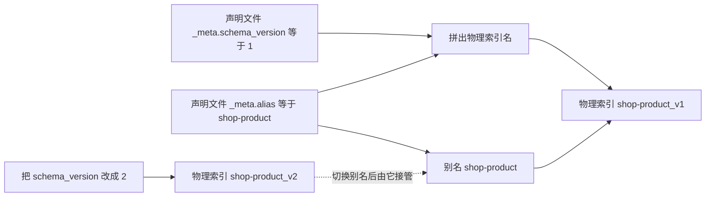
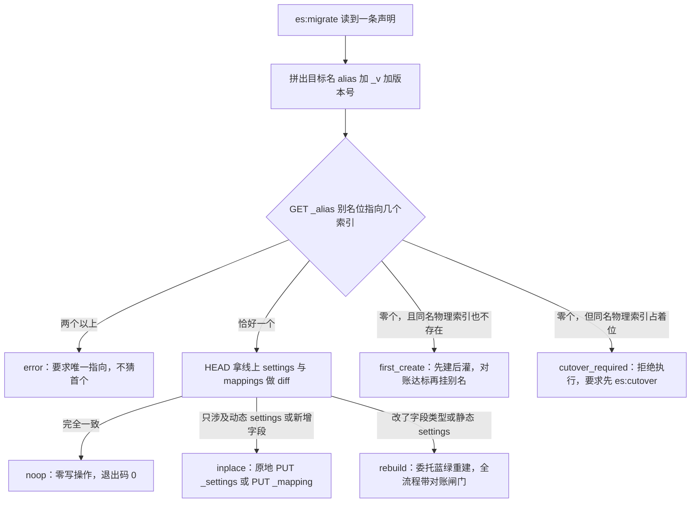
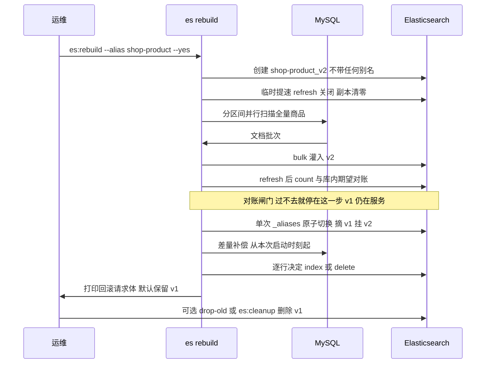
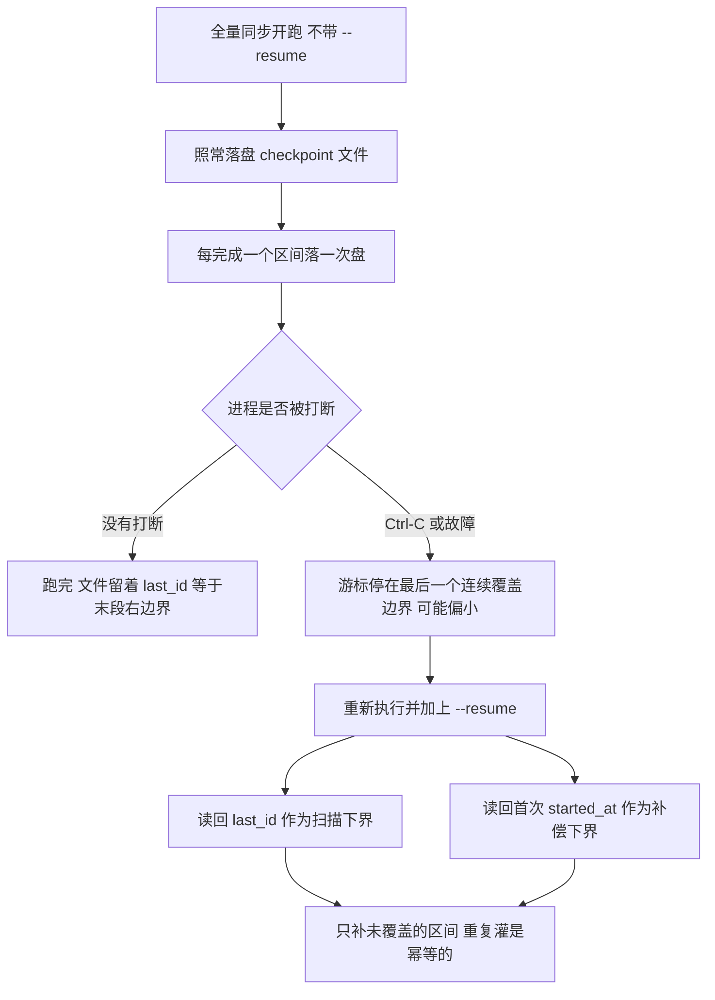

# ES 运维与开发手册（商品索引为主线）

> **新人只读这一份就够。** 另外三份 —— [`docs/es-design.md`](./es-design.md)、[`docs/es-usage-and-php-diff.md`](./es-usage-and-php-diff.md)、[`internal/es/README.md`](../internal/es/README.md) —— 是设计原理与历史差异的**存档**，不是操作说明书；若它们与本文口径不一致，以本文为准并请回报差异。
>
> 证据口径：所有 `文件:行号` 都回源码逐条核对过（2026-11-11）。ES 集群现场为当天只读实测结论，本文不含任何写操作演示。

## 怎么读

| 你是谁 | 该读哪几章 | 读完你会得到 |
|---|---|---|
| 今天要干活的人（运维、值班、把数据灌进去的人） | 第 0 → 4 章 | 能照着敲命令，知道每条命令敲下去会发生什么、出问题时看哪一行 |
| 明天要加新索引的接手开发 | 第 5 章（前半本也至少要读第 1、3 章） | 知道要动哪几个文件、每处干什么、商品是怎么被写死进去的 |

| 章 | 回答什么问题 |
|---|---|
| 第 0 章 | 那七个词到底是啥玩意，我该不该管 |
| 第 1 章 | 索引声明文件怎么写、写错会听到什么报错 |
| 第 2 章 | 一条 `es:migrate` 敲下去，中间发生了什么 |
| 第 3 章 | 六个命令各自的作用、时机、最小敲法 |
| 第 4 章 | 断点续传到底靠什么，为什么不会漏数据 |
| 第 5 章 | 加一个新索引 / 加一种导入要动哪些地方 |

---

## 第 0 章 先认识七个名词

这七个词在本项目里不是装饰，每一个都对应一段真实存在的代码和一个真实的现场动作。下面每个词都回答三件事：**它到底干什么**（必须打个比方）、**它是谁的规矩**（ES 官方标准 / 你们线上历史包袱 / 本方案自己加的）、**你需要管吗**。

| 名词 | 它到底干什么（打比方） | 是谁的规矩 | 你需要管吗 |
|---|---|---|---|
| **蓝绿重建** | 像高速上换轮胎：不把车停下线，而是在旁边车道停一辆一模一样的新车（`shop-product_v2`），把货搬过去、清点完数量，再一次性把路标从旧车挪到新车（切别名）。旧车原地停着，随时能开回来 | ES 官方支持的玩法（别名天生就是为这个），但「先灌满并对账达标才敢挪路标」这道闸门是本方案加的 | **每次改字段类型都要用**。日常不用；`es:migrate` 判定到 `rebuild` 时会自动帮你走这条路 |
| **同名割接** | 你们线上那个物理索引就叫 `shop-product`，而路标也叫 `shop-product` —— ES 里这两个名字不能同时存在，所以只能「拆掉旧房子的那一瞬间同时立好新房子」，一次操作做完，中间不能有空档 | **纯粹因你们线上历史包袱才有**：正常新项目一开始就用 `_v1`，根本不会撞到这个 | **一辈子只用一次**（每个历史索引一次）。用完之后 `shop-product` 就变成别名，这个命令以后再也用不上 |
| **对账闸门** | 搬家清点箱子：MySQL 说该有 5 个箱子，新仓库只数出 4 个，那就**不许把门牌号挪过去**，先把差额查清楚。它不是日志、不是提醒，是「过不去就停在这一步」的硬闸 | 本方案自加的（ES 自己没有「灌完必须等于库里数」这种概念） | 日常不用管，它默默工作。只有它拦下来时你会看到一条明确报错，那时才需要管 |
| **差量补偿** | 搬家的中间那十分钟里，家里人还在往旧箱子里放东西。搬完把门牌号挪好后，必须再回看一眼「从搬家开始那一刻起被改动过的东西」，把它们补进新仓库；这段时间被删掉的东西也要在新仓库里删干净 | ES 官方没有，是你们业务在跑、数据一直在变这个事实逼出来的 | 完全不用管，`es:rebuild` / `es:cutover` 结尾自动跑。但要知道**它不能跳过**（`--force` 也放行不了它） |
| **断点续传** | 搬家搬到一半停电了。来电后不是从头再搬，而是看门口那本记了「搬到哪个编号」的登记簿，从那个编号接着搬 | 本方案自加的（ES 的 bulk API 本身不管进度） | 只在「灌数跑到一半挂了」时用一次：`--resume` |
| **失败重放** | 搬家时有三个箱子被门卡住了，你把它们单独登记在一张纸条上。障碍清掉后，**只搬纸条上这三箱**，不用重搬全屋 | 本方案自加的（失败明细由 bulk 逐条回执收集落盘） | 只在灌数报「有 N 条 item 级失败」时用一次：`--retry-failed <纸条路径>` |
| **灌入期调优护栏** | 搬家当天先把「每十分钟清点一次」的规矩临时关掉、把「每个房间必须复印两份」临时改成零份，搬完**必须原样恢复**。护栏 = 只允许对「还没有对外开放的那个仓库」这么做，一旦它挂着门牌号对外营业就绝不临时改 | ES 官方建议的批量导入手法；「对持有别名的索引禁止调优 + 无论成败都恢复」这两条约束是本方案自加的 | 不用管，默认开着（`--tune-ingest=true`）。只有一种情况要留意：单节点集群灌数期间健康度会呈 yellow，那是副本清零的正常表现，不是故障 |

一句话总结这七者的分工：**蓝绿重建 / 同名割接** 是两种「换索引」的路径，**对账闸门 / 差量补偿 / 灌入期调优护栏** 是换索引过程中的三道安全带，**断点续传 / 失败重放** 是灌数据半途出问题时的两条补救路。

### 三条红线（先把不能碰的地方记住）

| 红线 | 为什么 |
|---|---|
| 不要手工 `DELETE` 正在被别名指向的索引 | 搜索线上直接不可用；本方案所有删除动作都走 `es:cleanup`，它有「仍被别名持有即不可删」的硬护栏 |
| 不要把 `_aliases` 切换拆成两次请求 | 参见第 3 章割接一节：中间会出现「名字既不是索引也不是别名」的写入黑洞 |
| 不要手改 `runtime/es_sync/*.checkpoint.json` 里的数字 | 它是游标，改错一段就少灌一段；要重来请删掉该文件而不是编辑它 |

---

## 第 1 章 配置文件怎么写

本章是「我要改 mapping / 我要新加一个索引」的第一站。所有结构事实都在一个文件里，先把这个文件写对，后面所有命令才有意义。

### 1.1 文件放哪、叫什么名

| 位置 | 认什么扩展名 | 谁在用 |
|---|---|---|
| `internal/es/indices/*.jsonc` | **只认 `.jsonc`** | 内置进二进制的那份（正式路径） |
| `--indices-dir` 或 `elasticsearch.indices-dir` 指定的目录 | `.json` 与 `.jsonc` **都加载** | 外置覆盖（不发版改结构） |

三条源码依据：

- 内置那份必须是 `.jsonc`：编译期用 `//go:embed indices/*.jsonc` 挑选文件（`internal/es/embed.go:17`），目录名常量 `EmbeddedIndicesDir = "indices"`（`embed.go:21`），列清单时也是 `fs.Glob(FS, "indices/*.jsonc")`（`embed.go:26-27`）。你把内置文件改名成 `.json`，它根本不会进二进制。
- 外置目录两种都认：`var DefinitionFileExts = []string{".jsonc", ".json"}`（`internal/es/registry.go:31`，注释在 `:29-30` 说明「允许 `.json` 是为了让外置目录能直接堆放从 ES 导出的 mapping 文件」），命中判定在 `hasDefinitionExt`（`registry.go:198-199`）。
- 目录优先级：`--indices-dir` 显式值 > 配置里的 `elasticsearch.indices-dir` > 内置 go:embed（`resolveIndicesDir`，`registry.go:112-121`；配置键定义 `conf/conf.go:91`，`conf/config.yml:51` 现为空串＝用内置那份）。
- 外置目录里**一个声明文件都没有**会直接报错，不会静默回落到内置那份（`registry.go:103`）：`es: 索引目录 <绝对路径> 下没有任何 [....jsonc ....json] 文件（期望至少一份 *.jsonc 索引声明）`。

> **小流程（一句话记住加载顺序）**
> `--indices-dir` 给了吗？ → 给了就用它（空目录=报错）；没给 → 看 config 的 `indices-dir`；还没配 → 用二进制里那份。

### 1.2 文件里可以一行注释都没有

解析器是 JSONC 到 JSON 的注释剥离（`internal/es/jsonc.go` 的 `Strip`，`jsonc.go:27-37` 写明规则：逐字节扫描、字符串字面量里的 `//` 原样保留、块注释替换为一个空格、**不处理尾随逗号**）。所以：

- 一份纯 JSON、一行注释都没有的文件**完全可用**，注释只是可选的可读性增强。
- 反过来，**尾随逗号是非法的**：`Strip` 不帮你删，`encoding/json` 会直接拒绝，而 ES 的 settings/mappings 本身也拒绝尾随逗号。

### 1.3 最小可用文件模板

这是「能跑起来」的最短形状，可直接复制后替换 settings / mappings：

```jsonc
{
  "_meta": {
    "alias": "shop-product",
    "schema_version": 1
  },

  "settings": {
    "refresh_interval": "1s",
    "number_of_shards": 15,
    "number_of_replicas": 1
  },

  "mappings": {
    "dynamic": "strict",
    "properties": {
      "id":   { "type": "long" },
      "name": { "type": "text" }
    }
  }
}
```

对照现成的真实文件：`internal/es/indices/product.jsonc` 的 `_meta` 块起于 **第 21 行**（`alias` 在第 22 行、`schema_version` 第 23 行、`status` 第 24 行）；`internal/es/indices/orders.jsonc` 的 `_meta` 块起于第 31 行、`status: "draft"` 在第 34 行。

### 1.4 `_meta` 挂在哪，是给谁看的

**位置**：`_meta` 是**文件顶层**的键，与 `settings` / `mappings` 平级（看 `product.jsonc:21`）。它**不是** ES 的 `mappings._meta` —— 如果你把它写进 `mappings` 底下，本方案读不到它，会按「缺少 `_meta`」拒绝加载。

**它是给我们程序看的身份信息，不是给 ES 的结构**。拼装发往 ES 的请求体时，`_meta` 和 `aliases` 这两个顶层键会被整块剔除（`BodyJSON`，`internal/es/definition.go:209-218`，剔除逻辑就是那个 `if k == MetaKey || k == AliasesKey { continue }`；`:203-207` 的注释说明原因 —— ES 在 create_index 阶段会以 unknown key 拒绝它们）。因此：

- ES 侧完全看不到 `_meta`：2026-11-11 实测 `curl shop-product_v1/_mapping | grep -c _meta` 结果为 **0**。
- 想知道线上索引到底是按哪份声明建的，不能靠问 ES，只能靠 `es:status` / `es:migrate --dry-run` 打印的「声明来源 + 指纹」—— 指纹是 settings+mappings 算出来的（`Fingerprint`，`definition.go:191`）。

### 1.5 `_meta` 逐字段表

| 字段 | 必填 | 缺省 | 写错会怎样（原文报错） |
|---|---|---|---|
| `alias` | **是** | 无 | `_meta.alias 不能为空（物理索引名与别名都依赖它）`（`definition.go:505`） |
| `schema_version` | **是** | 无 | `_<meta>.schema_version=0 非法，必须是从 1 开始的整数版本号`（`definition.go:514`） |
| `status` | 否 | `active`（`DefaultStatus`，`definition.go:50`） | `_<meta>.status="xxx" 非法，只能是 active 或 draft`（`definition.go:530`）；常量在 `:42`（active）/ `:45`（draft） |
| `date_format` | 否 | 无 | 仅作约定说明 |
| `copy_to_only_fields` | 否 | 无 | 同上 |
| `requires_plugins` | 否 | 无 | 不填就没有「缺插件先拦住」这层保护；填了会进 `es:status` / migrate 前置校验 |
| `next_version_rule` | 否 | 无 | **纯注释性质**，程序不据此自动升版本（见 1.7） |
| `notes` | 否 | 无 | 无 |

整块 `_meta` 缺失是**硬失败**，文件根本装载不进来（`definition.go:118-120` 的 `objectAt(body, MetaKey)` 失败分支），报错原文（2026-11-11 实测）：

```
es: 索引声明 <路径> 缺少 _meta（本方案的结构事实源必须自带元数据）: 缺少 "_meta" 字段
```

外层文案在 `definition.go:120`，内层的 `缺少 "_meta" 字段` 来自通用取值函数 `objectAt`（`definition.go:576-586`，具体文案 `fmt.Errorf("缺少 %q 字段", key)` 在 `:579`）。

另外一条只有本方案才有的硬约束：`mappings.dynamic` 不是 `strict` 会被直接拒绝加载（`definition.go:131`）。**这条护栏只在走命令建索引时生效**，手工 `PUT` 建索引不享受。

### 1.6 物理索引名是拼出来的，不写在任何文件里

命名公式（这是全手册唯一需要背下来的公式）：

```
IndexName(alias, version)  =  alias + "_v" + version
例：shop-product + _v + 1  =  shop-product_v1
```

源码：`IndexName`（`internal/es/definition.go:221-223`），分隔符常量 `VersionSeparator = "_v"`（`definition.go:53`），装配点把结果写进 Definition 的 `name` 字段（`definition.go:139`）。

这张图在讲：别名、物理索引、文件里的版本号三者是怎么互相牵制的。



### 1.7 从 PHP 来的人最容易踩的两点

| 你以前习惯的 | 这里是相反的 | 后果与正确做法 |
|---|---|---|
| 程序自己数出 `v_0` / `v_1`，每次发布自动 +1 | **版本号来自文件，不是程序数的**。`_meta.schema_version` 不改，目标名就永远不变；`NextVersionName`（`definition.go:226`）与 `admin.WriteIndexName`（`internal/es/admin/alias.go:163`）在非测试代码里**零调用**，`next_version_rule` 也只是给人看的约定 | 改了 mapping 却忘了把 `schema_version` 从 1 改成 2，命令会认为「目标就是现在这个索引」，于是不重建、只可能报漂移；要出新版本必须**手改文件里的数字** |
| 迁移完把旧索引 `close` 掉 | 这里**不 close**。旧索引默认原地保留，用来随时回滚 | 保留的残留靠两条路收敛：`es:rebuild --drop-old --yes` 顺手删，或事后用 `es:cleanup` 列出来再删（见第 3 章） |

---

## 第 2 章 一条命令敲下去，中间发生了什么

本章以 `es:migrate --alias shop-product` 为主线做一次**逐步走查**。看懂这一条，其余五条的骨架是一样的。

### 2.1 第 0 步：先把命令名写对（两个 `es`）

```bash
go run ./cmd/cli es es:migrate --alias shop-product --dry-run
#             ^^^ 父命令   ^^^^^^^^^^ 子命令本身的叫法
```

六个子命令的 `Use` 自带 `es:` 前缀（`cmd/cli/es_status.go:28`、`es_migrate.go:30`、`es_rebuild.go:32`、`es_cutover.go:27`、`es_sync_products.go:23`、`es_cleanup.go:44`），父命令是 `es`（`cmd/cli/es.go:16`）。写成 `es migrate` 会被 `validateEsSubCommandArgs`（`cmd/cli/es.go:57`）拦住，**退码 1** 并给出建议：`es 没有子命令 "migrate"：… 正确用法 es es:<sub>（是否想用 es:migrate？）`（文案 `es.go:62` 与 `:64`）。无参 `es` 仍打印帮助并退码 0。

为什么要单独一棵 `es` 子树：`cmd/cli` 是三入口之一，ES 工具族被装配成 `es` 子树并独占一层 `PersistentPreRunE`（Cobra 只执行最近一层，`es.go:94`），于是 `es:*` 只初始化 ES / MySQL / Redis，**不初始化 Kafka**；`es` 父命令自身在该钩子里短路，所以参数写错时连不上数据库也不会先炸。

### 2.2 第 1 到第 6 步：走查表

| 步 | 发生了什么 | 源码 | 敲完会看到 |
|---|---|---|---|
| 1 | 读配置 `elasticsearch` 段建 ES 客户端 | `bootstrap.go:110`（`WithElasticsearch`）→ `:350-352`（`initES` 取 `global.CONFIG.Elasticsearch`）；`conf/config.yml:46-51` 是 enabled/hosts/username/password/indices-dir | `enabled=false` 时整条命令打「Elasticsearch 未启用（elasticsearch.enabled=false），跳过迁移」并**退码 0**（`cmd/cli/es_migrate.go:126-129`） |
| 2 | 按目录优先级加载索引声明，建 Registry | `es.LoadRegistry`（`cmd/cli/es_migrate.go:135` → `internal/es/registry.go:224`），实际干活的是 `LoadDefinitions`（`registry.go:40`） | 装载失败会带文件路径与原因，直接中止 |
| 3 | 按 `--alias` 圈定要处理的声明；`all`／空＝全部可执行声明 | `pickDefinitions`（`migrate.go:107` 调用，函数体 `:130`） | `--alias` 填了没登记的别名 → 立刻报错 |
| 4 | 确认范围（实写需要 `--yes` 或 TTY 交互；`--dry-run` 免确认），然后取共享客户端 | `es_migrate.go:144-154`；`admin.Client()` 在 `:156`；超时/信号上下文 `:160-167` | 非 TTY 又没带 `--yes`：`非 TTY 环境必须显式传 --yes 才能执行迁移（可能触发蓝绿重建/首建写操作）` |
| 5 | **拼目标索引名**：`def.Name()` ＝ `alias + "_v" + schema_version` | `definition.go:139` / `:221-223` | 不打印也没关系，下一步的分级结论里会带名字 |
| 6 | **探测别名位现状**：先 `GET /_alias/<alias>` 看有没有指向；没有再 `HEAD /<alias>` 看是不是同名物理索引 | `migrateOne`（`migrate.go:147`）里的 `c.AliasTargets`（`:166`）与 `c.IndexExists`（`:186`）；探测原始事实三件套定义在 `AliasProbe`（`internal/es/cutover.go:527-532`） | 每条声明一行 `[migrate] <alias>: <结论>` |

这张图在讲：`es:migrate` 拿到一条声明后，靠哪几个判断走到六个不同的出口。



### 2.3 你昨天撞到的那段输出，是正确的

昨天实跑 `es es:migrate --alias shop-product` 得到（原样，一字未改）：

```
shop-product   cutover_required ✗ 存量未割接，需先执行 es:cutover
Error: es: migrate 有 1/1 条 Definition 失败：shop-product: 存量未割接，需先执行 es:cutover
exit status 1
```

逐行拆：

| 那一行 | 它是谁打的 | 含义 |
|---|---|---|
| `shop-product   cutover_required ✗ 存量未割接，需先执行 es:cutover` | `migrateCutoverRequired`（`internal/es/migrate.go:406-413`）：`Verdict` 在 `:408`、`Error` 文案 `"存量未割接，需先执行 es:cutover"` 在 `:413`；完整原因（dry-run 形态）在 `:409`：`别名位 shop-product 仍是物理索引（存量未割接），migrate 不做不可逆割接；请先执行 es:cutover --alias shop-product` | 走到了流程图最右那条出口：**你的 `shop-product` 是个物理索引，把别名的名字占住了** |
| `Error: es: migrate 有 1/1 条 Definition 失败：…` | `RunMigrate` 末尾聚合（`migrate.go:121-124`），`1/1` ＝ 失败条数 / 总条数 | 不是崩溃，是「本次范围内有一条没做成」的汇总 |
| `exit status 1` | 上面那个非 nil error 让 Cobra 以 1 退出 | 脚本判错只看退码即可 |

**为什么这是正确行为**：割接是不可逆动作（旧物理索引连同数据会在这次原子操作里消失），migrate 作为「日常结构收敛」入口**绝不自作主张帮你做不可逆的事**，它只指路。

**当前线上状态**（2026-11-11 只读实测）：割接**已经做过了** —— 别名 `shop-product` → 物理索引 `shop-product_v1`，5 篇文档，`is_write_index=true`。所以现在再跑 `es:migrate` 会走图中左半边（noop / inplace / rebuild），不会再看到 `cutover_required`。同为历史包袱的 `shop-order` **仍是物理索引、仍未割接**，对它跑 migrate 就会得到上面那段输出。

### 2.4 判定结果一共七种

`es:migrate` 的 `verdict` 全集（`internal/es/migrate.go:28-36`，七个值）：

| verdict | 意义 | 动写了没 | 退码 |
|---|---|---|---|
| `noop` | 线上结构与声明一致 | 没动（`migrate.go:229`） | 0 |
| `inplace` | 只提交动态 settings / 新增字段（`migrate.go:241`、`:278`） | `PUT _settings` / `PUT _mapping` | 成功 0 |
| `rebuild` | 判定要重建，已委托蓝绿重建（`delegateRebuild`，`migrate.go:284`；日志 `:234`） | 全流程：建新索引＋灌＋对账＋切别名＋补偿 | 成功 0 |
| `first_create` | 别名与同名索引都不存在，首建（`migrateFirstCreate`，`migrate.go:317`；日志 `:348` / `:388`） | 建索引 → 灌数 → 对账 → **达标后**才单次挂别名 | 成功 0 |
| `cutover_required` | 别名位被同名物理索引占了（`migrate.go:406-413`） | **完全没动** | **1** |
| `skipped_not_active` | 该声明 `status=draft`，不进可执行清单（`migrate.go:157-161`） | 没动 | 0（只是跳过） |
| `error` | 判定或执行失败，例如别名指向多个索引（`migrate.go:174-178`） | 不确定 | 1 |

---

## 第 3 章 六个命令：作用、时机、敲哪条

本章只给**最小形式**。所有可选参数「默认值已调好，不用动」；真要动，第 1、2 章已给了源码位置可查默认值出处。六个 flag 表全部按源码里的注册行照抄（`cmd/cli/es_*.go` 的 `init()`）。

| 命令 | 一句话作用 | 什么时候敲 |
|---|---|---|
| `es:status` | 体检，只读 | 任何时候，出问题第一件事 |
| `es:migrate` | 结构收敛总入口，自动判五种路 | 每次发版前、改完声明文件后 |
| `es:sync-products` | 只灌数据，不碰结构不碰别名 | 补数据、指定商品重灌、定时增量 |
| `es:rebuild` | 结构变了就蓝绿重建并切别名 | 改了字段类型 / 分片数 |
| `es:cutover` | 把占着别名位的物理索引换成同名别名 | 历史包袱清一次 |
| `es:cleanup` | 清理没别名挂载的 `*_vN` 残留 | 重建失败留下孤儿索引时 |

### 3.1 `es:status` —— 体检

```bash
go run ./cmd/cli es es:status
go run ./cmd/cli es es:status --alias shop-product --json   # 单索引、机器可读
```

`--alias` 留空＝检查 Registry 里**全部登记项**（含 `draft`，因为它走 `reg.All()`，`cmd/cli/es_status.go:301`）；`--json` 时进度日志改走 stderr（`es_migrate.go:170-172` 同款处理）。会报：集群健康、已装插件、每条声明的存在形态（别名 / 物理索引 / 不存在）、读写目标、计数对账。

**计数对账只对有登记口径的别名做**：`esStatusDBCounters` 目前只有一条 `"shop-product"`（`cmd/cli/es_status.go:154-156`），其余索引如实报「不可比」—— 这是刻意设计（口径错配比没比更有害），新增索引时在这里补一行即可。

### 3.2 `es:migrate` —— 结构迁移总入口

```bash
go run ./cmd/cli es es:migrate --alias shop-product --dry-run   # 永远先预演
go run ./cmd/cli es es:migrate --alias shop-product --yes       # 实跑（非 TTY 必须带 --yes）
```

自动判定 noop / 原地 / 需重建 / 需割接（判定表见第 2 章 2.2）。`--alias` 缺省是 `all`（`cmd/cli/es_migrate.go:78`），所以不带 `--alias` 就是把所有 active 声明都收敛一遍。想跳过 diff 强制重建用 `--force-rebuild`（`:86`）。

### 3.3 `es:sync-products` —— 只灌数据

```bash
go run ./cmd/cli es es:sync-products                                   # 全量重灌默认目标
go run ./cmd/cli es es:sync-products --ids 12,15                       # 只灌指定 id
go run ./cmd/cli es es:sync-products --since 2026-11-01                # 只灌这天之后改过的
go run ./cmd/cli es es:sync-products --resume                          # 断点续传（第 4 章）
go run ./cmd/cli es es:sync-products --retry-failed runtime/es_sync/failed_shop-product_xxx.jsonl
go run ./cmd/cli es es:sync-products --dry-run                         # 只读预演，零写
```

flag 与默认值（全部照 `cmd/cli/es_sync_products.go:35-55`）：`--index` 默认 `shop-product`（`:35`）、`--chunk-size` 默认 1000（`:36`）、`--concurrency` 默认 4（`:37`）、`--range-multiplier` 默认 4（`:38`）、`--bulk-size` 默认 3000（`:39`）、`--bulk-max-mb` 默认 0＝交给 admin（`:40`）、`--limit`（`:41`）、`--ids`（`:42`）、`--since`（`:43`，接受 RFC3339 或 `2006-01-02`）、`--tolerance` 默认 0（`:44`）、`--max-failures` 默认 100（`:45`）、`--retry-failed`（`:46`）、`--resume`（`:47`）、`--dry-run`（`:48`）、`--tune-ingest` 默认 true（`:49`）、`--yes`（`:53`）。

这张图在讲：`es:sync-products` 内部一条数据是怎么从 MySQL 走到 ES 的，以及反压和游标发生在哪一环。


要点三条，都不需要调：① 队列是**有界**的（`internal/es/sync/runner.go:77-78`，缓冲 ＝ 并发 × `defaultDocsChBufferMulr`＝2，常量在 `sync/provider.go:216`），ES 变慢时自动阻塞 MySQL 读取，不需要手写限速；② scanner 与 writer 各自成池，用 errgroup 收口（`runner.go:74`、`:76`）；③ writer 侧才做 HTML 清洗与序列化，scanner 只丢原始行（`runner.go:21` 的结构注释）。

**失败重放怎么来的**：item 级失败会落成一份 JSONL，文件名形如 `failed_<target>_<YYYYMMDD_HHMMSS>.jsonl`（`failureFileName`，`internal/es/admin/bulk.go:373-374`），默认落在 `runtime/es_sync`（`defaultFailureDir`，`bulk.go:39`）。攒够 `--max-failures` 就中断整任务。把它喂回 `--retry-failed` 即只重投这些文档（读取函数 `ReadFailures`，`bulk.go:456`）；缺 `_id` 的失败样本会被标记为 `missing_id`（`bulk.go:186`），这类**无法幂等重投**，读取时会告警跳过（`bulk.go:473` 的注释），只能按 id 手工 `--ids` 补。

### 3.4 `es:rebuild` —— 结构变更时的蓝绿重建

```bash
go run ./cmd/cli es es:rebuild --alias shop-product --yes                # --alias 必填
go run ./cmd/cli es es:rebuild --alias shop-product --yes --drop-old     # 成功后顺手删旧索引
```

`--alias` 默认空串且必填（`cmd/cli/es_rebuild.go:86`，帮助文本写明「rebuild 的前置是该别名已存在」）。`--drop-old` 默认 false＝**保留旧索引以便随时回滚**（`:94`）；`--tolerance` 负值表示**永不可达标**、不会被当成 0 用（`:88`）；`--force` 只放行对账这一道（`:96`）；`--keep-new-on-failure` 默认 true，失败时把灌到一半的新索引留着排查（`:95`）。

八步实况（顺序照 `internal/es/rebuild.go` 的日志）：

| 步 | 内容 | 源码 |
|---|---|---|
| 1/8 | 前置校验：别名指向、目标名、插件 | `rebuild.go:371` |
| 2/8 | 建**新索引**（此阶段**不带别名**） | `:452` |
| 3/8 | 灌入期提速：refresh 置 -1、replicas 置 0 | `:496` |
| 4/8 | 从 MySQL 全量灌入，`op_type=index` 幂等 | `:503` |
| 5/8 | `_refresh` + `_count` 对账（闸门在切别名**之前**） | `:515`、真实回读 `:530` |
| 6/8 | **单次** `POST /_aliases` 原子切换 | `:541` |
| 7/8 | 差量补偿，下界＝编排启动时刻 | `:557` |
| 8/8 | 完成，默认保留旧索引并打印回滚请求体 | `:576-579` |

这张图在讲：第 2 到第 8 步的时间先后，以及「哪一步之前旧索引还在服务」。



**为什么 `--force` 放行不了补偿**：`opts.Force` 只在第 5 步对账分支被读（`rebuild.go:532-537`）；第 7 步补偿（`:551-573`）没有任何 force 判断，补偿失败或有 item 级失败都会如实上抛 —— 别名已经切了，窗口增量没收敛完不算成功。

### 3.5 `es:cutover` —— 一次性同名割接

```bash
go run ./cmd/cli es es:cutover --alias shop-product --dry-run
go run ./cmd/cli es es:cutover --alias shop-product --yes
```

`--alias` 默认就是 `shop-product`（`cmd/cli/es_cutover.go:87`）。七个阶段照 `internal/es/cutover.go` 的日志：`[1/7]` 前置校验 `:998` → `[2/7]` 建目标索引 `:1092` → `[3/7]` 灌数 `:1139` → `[4/7]` 对账 `:1159` → `[5/7]` **原子割接** `:1187` → `[6/7]` 差量补偿 `:1211` → `[7/7]` 校验别名 `:1229`。

关键三条：

1. **旧物理索引在同一次原子请求里被删掉**（不是只摘别名）。请求体是「先 `remove_index` 后 `add`」两条 action 装进一个 `POST /_aliases`（`CutoverAliasBody`，`cutover.go:614-631`，构造见 `:622-625`，`is_write_index=true`）。
2. **数据靠从 MySQL 重灌**：旧的那份连同索引一起消失，新索引里的内容全是第 3 步灌出来的。
3. **没有回滚，恢复手段只有一个**：重跑本命令（或 `es:sync-products`）再来一遍（`cmd/cli/es_cutover.go:37-40` 把这条写成帮助文本）。这与 `es:rebuild`「保留旧索引、一条回滚请求体就能切回去」是两套完全不同的语义。
   幂等护栏：别名位已经是别名 → 打印现状、退码 0、不做任何变更（`cutover.go:1043-1045`）；目标索引已存在 → 拒绝覆盖并中止，绝不 DROP（`:541-542`）。

这张图在讲：为什么同名割接只能有一条路，以及拆成两步会在中间掉进写入黑洞。


同名的冲突在代码里被硬拦两处：`CutoverAliasBody` 一见 `alias == target` 就报「目标索引名不能与别名同名（ES 中二者绝对互斥）」（`cutover.go:618-621`）；CLI 入口更早拦一次（`cmd/cli/es_cutover.go:163`）。

### 3.6 `es:cleanup` —— 清残留

```bash
go run ./cmd/cli es es:cleanup                                   # 默认 --list-only=true 只列不删
go run ./cmd/cli es es:cleanup --older-than 168h                 # 放宽/收紧年龄线
go run ./cmd/cli es es:cleanup --index shop-product_v2 --list-only=false --yes
```

三条护栏（照 `cmd/cli/es_cleanup.go:49-51` 的帮助文本与实现）：

| 护栏 | 实现 |
|---|---|
| 只碰形如 `*_v<数字>` 的版本化索引；`shop-product` 这种无版本尾缀的一律不碰 | 正则 `cleanupVersionRe`（`es_cleanup.go:41`）、批量模式判定 `:176-178` |
| 仍被**任何**别名指向的索引永不列入候选 | 先读全量别名持有集合（`:142-145`），命中即跳过（`:179-181`） |
| 创建时间不足 `--older-than`（默认 168h＝7 天）的不删；`creation.date` 缺失时 fail-closed 跳过并告警 | `passesAgeGate`（`:259`），调用点 `:185-190` |

`--index` 单索引模式**确实绕过年龄线**（`:155-169` 这条分支不进 `passesAgeGate`），但**前两条红线仍然强制**：`checkSingleIndexTarget`（`:242`）先过版本尾缀、再查别名持有，注释 `:156-157` 明确写「红线优先于『无别名即安全』的直觉判定」。`--yes` 在非 TTY 下是硬要求（`:119`）。

### 3.7 两条必须如实知道的语义坑

**坑①：重灌不会删掉下架 / 已删除的商品。**

全量同步的扫描 SQL 带 `is_show = 1` 硬过滤（`internal/es/sync/product.go:103`，函数体 `filter` 在 `:102`，口径注释 `:100-101`；扫描列清单 `:38-40` 里专门补了 `is_show` 一列）。这意味着**下架商品根本没被扫到**，你重灌一百遍，它在索引里仍然是旧文档 —— 幽灵文档。

要清掉幽灵文档**只有一个办法：`es:rebuild`**。因为它结尾的差量补偿走的是另一条 SQL：`Unscoped()`、**不含 `is_show`、也不含 `is_del` 过滤**（`internal/es/sync/delta.go:11-13` 与 `:61-62`，实现 `defaultCompensateScan` `:75` / `:123`，补偿入口 `Compensate` `:178`），逐行按装配结果决定发 `index` 还是 `delete`，所以软删行与下架行都能被看见并删除（`delta.go:39` 的 `Scanned` 注释即「含软删/下架，Unscoped 口径」）。

> 一句话记法：**「重灌」是往索引里加/盖，只有「重建」才会从索引里删。**

**坑②：`es:sync-products --index` 不要乱传。**

```
高危：--index 传一个未注册或 draft 的索引名
```

这条曾经会**静默兜底**到商品定义，再经写死的 productProvider 把【商品】数据灌进你以为是订单的目标里，命令还报成功。该缺陷现在已被正面修掉：CLI 只要**显式传了** `--index` 就开启严格校验（`cmd/cli/es_sync_products.go:185` 用 `f.Changed("index")` 决定 `StrictIndex`，透传给 `opts.StrictIndexLookup`，消费点 `sync/product.go:255`），命中未登记 / `draft` 时在任何 MySQL 触达与 bulk 之前就报错并列出当前可用（active）名称（防线在 `sync/product.go:860-876`，回归测试 `internal/es/sync/index_lookup_test.go`）。

仍然要提醒的两点残余风险：① **不传** `--index` 时走的是友好兜底分支（`sync/product.go:878-893`：target 匹配不上会回落 `ProductAlias`，再回落「唯一可执行定义」），编程式调用（rebuild / cutover / migrate 的适配器）同样不严格；② 目标写成物理索引名（如 `shop-product_v1`）时灌的是别名当前指向的那个索引，容易和蓝绿过程中的新索引搞混。**结论：需要指定就老老实实写 active 别名，别靠猜。**

### 3.8 脚本里怎么判对错

| 现象 | 退码 | 该怎么读 |
|---|---|---|
| 正常完成（含 noop、含 `skipped_not_active`、含「已割接所以 cutover 什么都不做」） | 0 | 成功 |
| `cutover_required`、对账不达标、补偿有失败、目标索引已存在 | 1 | 真失败，看最后一条 `Error:` 行 |
| `enabled=false` 被跳过 | 0 | **注意**：这是「没做」而不是「做好了」；CI 里请先断言开关 |
| 命令名写错（漏 `es:` 前缀） | 1 | 参数错误，会附建议名 |

`--json` 输出时进度日志改走 stderr（`es_migrate.go:170-172` 等），但 `[dry-run]` 之类的计划打印仍可能混在同一通道里；脚本取 JSON 建议用 `sed -n '/^{/,$p'` 从第一个左花括号起截取。

---

## 第 4 章 断点续传到底靠什么

今天被问的原题：「跑到一半断了，`--resume` 凭什么知道从哪儿接着灌？」答案就一个文件。

### 4.1 文件在哪、长什么样

| 项 | 值 | 源码 |
|---|---|---|
| 路径 | `runtime/es_sync/<target>.checkpoint.json` | 基目录常量 `checkpointBaseDir = "runtime/es_sync"`（`internal/es/sync/product.go:44`）；拼名函数 `checkpointPath`（`product.go:1068-1070`，target 里非法字符会被净化） |
| 字段 | `target` / `started_at` / `total` / `last_id` | 结构体 `checkpoint`（`product.go:909-914`） |
| 是否被 git 忽略 | 是，`runtime/es_sync/` 在 `.gitignore` 里 | — |

内容样例（字段名照结构体的 tag）：

```json
{ "target": "shop-product", "started_at": "2026-11-11T09:12:33+08:00", "total": 5, "last_id": 128 }
```

### 4.2 游标只推进到「最小连续覆盖右边界」

这是整章唯一需要动脑的地方，也是「宁可重灌、绝不留漏」的落点。

全量灌是多个区间并行跑的。如果 `last_id` 就记「目前见过的最大 id」，那么 id 小的区间落后时，它的整段都会被游标越过 —— 断点续传就永久漏掉那一段。所以记账是按**区间**记的（`recordRange`，`product.go:997`），游标推进由 `frontierLocked` 计算（`product.go:1048`，规则写在 `:1042-1047`）：

- 已完成的区间：把边界推到它的右边界，继续看下一个；
- 遇到的第一个「进行中」区间：只推到它区间内已连续读出的 `last_id`，然后**停**；
- 尚未开始的区间：立刻**停**，其后任何进度都不计入；
- 区间计划为空（没登记过 plan）：返回 0，保守不推进（`:1047`）；
- 算出的新边界不大于现有游标时不落盘、不回退（`:1015`）。

### 4.3 续传时读回什么

这张图在讲：一次正常跑留下的文件，中断之后被 `--resume` 读回，两个字段各自派什么用场。



四个细节都有源码兜底：

1. **正常跑也留文件**，不是只有 `--resume` 才落盘：checkpoint sink 始终创建（`product.go:280-281` 的注释「使首次全量也落盘，中断后 `--resume` 可达」）。
2. `last_id` 变成扫描下界，并且**强制退化成单区间单游标**：`applyResumeState`（`product.go:539-546`）把 `minExclusiveID = cp.LastID`，同时把 `Concurrency` 与 `RangeMultiplier` 都置 1（`:542-543`），打印 `[resume] 从 id=%d 续传（单区间模式）`（`:544`）。这样续传阶段 id 单调、不跳段，代价是并行度归零 —— 这是「不漏」换来的必然选择。
3. **`started_at` 用的是首次值**：加载到已有 checkpoint 时走 `restoreCheckpointSink`，原样保留 `StartedAt` 与 `Total`（`product.go:290-293`，函数与口径注释在 `:949-955`，`:951-952` 明说「差量补偿应以 `StartedAt`（任务首次启动时刻）为下界，而不是恢复时刻，写错会让补偿漏掉中断窗口内的变更」）；`Total` 也刻意**不**在 resume 路径覆盖（`:298-303`）。
4. 找不到文件不报错，如实从头来：打 `[resume] 未找到 checkpoint，将从头全量执行`（`product.go:288`）；文件内容损坏才失败（`loadCheckpoint`，`:1072-1080`）。

**重灌为什么安全**：bulk 写入用 `op_type=index`（覆盖语义），同一 `_id` 重复灌只会盖掉旧值，不产生重复文档 —— 所以「宁可多灌一段」没有副作用，「少灌一段」才有。

---

## 第 5 章 后半本：新增一个索引 / 新增一种导入

这一章写给「下次要加 `shop-order` 或者别的索引」的人。全程以订单为活例子。**本章只是说明书，本次没有改任何代码。**

### 5.1 全景：要动哪些地方

这张图在讲：一个新索引从零到能跑，要经过五层，每层落在哪个目录。

```mermaid
flowchart TD
    A["第一层 声明文件 internal/es/indices 下新增 x.jsonc"] --> B["第二层 文档结构 internal/es 下新增 x.go 与装配函数"]
    B --> C["第三层 数据源 internal/es/sync 下新增 x.go 实现分块扫描与区间计划"]
    C --> D["第四层 装载 Registry 自动扫描目录 由 status 决定是否接线"]
    D --> E["第五层 命令入口 cmd/cli 新增 es:sync-x 或复用通用命令"]
    E --> F["验证顺序 dry-run 首建 status 与 count 对账"]
    A -. 必填 _meta.alias 与 _meta.schema_version .-> G["元数据两行"]
    D -. 草稿态只解析不接线 .-> H["不进可执行清单"]
```

### 5.2 最小闭环清单（七步，每步给到文件与函数）

| 步 | 动哪里 | 具体要干什么 | 照商品抄哪一段 |
|---|---|---|---|
| 1 | `internal/es/indices/<x>.jsonc`（新建） | 顶层 `_meta` 至少两行：`alias` + `schema_version`；`settings` + `mappings`（`dynamic` 必须是 `strict`） | `product.jsonc:21-29` 的 `_meta` 块，以及它的 settings 层级写法 |
| 2 | `internal/es/doc.go`、`internal/es/doc_assemble.go` | 文档 struct（决定 ES 里有哪些字段、json tag 就是字段名）＋ 从 DB 行到文档的装配函数 | `ProductIndex`（`doc.go:29`）与 `BuildIndexDoc`（`doc_assemble.go:47`，注意它同时负责「这行该不该入索引」的资格判定） |
| 3 | `internal/es/sync/<x>.go`（新建） | 实现 Provider：`Bounds` 探上下界、`ScanRange` 按区间扫描、`Assemble` 装配文档；列裁剪必须包含装配判定要用的列 | `productProvider` 的 `filter` / `Bounds` / `ScanRange` / `Assemble`（`sync/product.go:102` / `:119` / `:125` / `:193`）；扫描列清单 `:38-40`，其中 `is_show` 是因为装配判定要用它而特意补进去的 |
| 4 | Registry 与状态 | **不需要注册代码**：`LoadDefinitions` 直接扫目录（`registry.go:40`）。落盘后 `status: "draft"` 表示「文件先存在、不进可执行清单」（缺省即 `active`，`definition.go:50`）；可执行判定 `Executable()`、清单 `ExecutableDefinitions()`（`registry.go:314`） | 商品是 `active`（`product.jsonc:24`）；订单现在也是 `draft`（`orders.jsonc:34`） |
| 5 | `cmd/cli/es_<x>.go`（新建）或复用 | 需要一个专属灌数命令（对齐 `es:sync-products`）：`Use` 要带 `es:` 前缀、flags 在 `init()` 注册、`AddCommand(esRootCmd)` 挂到 `es` 子树下 | 整个 `cmd/cli/es_sync_products.go`（`Use` 在 `:23`，flag 注册 `:34-55`，`esRootCmd.AddCommand` 在 `:57`） |
| 6 | `cmd/cli/es_status.go` | 让这个索引能做 ES/DB 计数对账：在 `esStatusDBCounters` 里加一条「别名 → 数 DB 的函数」 | `es_status.go:154-156`（现在只有 `"shop-product"`） |
| 7 | 验证顺序 | `es:<x> --dry-run` → 首建（`es:migrate --alias <新别名> --yes`）→ `es:status --alias <新别名>` → 手工 `_count` 与库内口径对账 | 第 2、3 章的走查即是标准动作 |

### 5.3 「商品」被写死的四处（＝泛化点）

想做一个通用的「任何索引都能灌」，需要动的是下面四处，其它地方已经是通用的：

| 写死点 | 位置 | 说明 |
|---|---|---|
| 别名常量 | `sync/product.go:30` `const ProductAlias = "shop-product"` | `SyncProducts` 靠它兜底定位声明（`:888`） |
| 入口函数与 Provider | `sync/product.go:248` `SyncProducts` / `:83` `newProductProvider` | 整个流水线 `sync/runner.go:Run`（`:30`）本身与商品无关，硬编码只在这层适配 |
| 装配函数与文档结构 | `doc_assemble.go:47` `BuildIndexDoc`、`doc.go:29` `ProductIndex` | 「该行该不该入索引」的资格判定也在这里 |
| 命令入口 | `cmd/cli/es_sync_products.go:23` | 命令名本身带 products |

DB 期望数的口径也是商品专属：`ProductDocCount`（`internal/es/cutover.go:82-93`），对账期望值的定义写在 `internal/es/sync/product.go:476` —— `SELECT COUNT(*) WHERE is_del=0 AND is_show=1`。

### 5.4 活例子：把订单 `shop-order` 真正接上线

**现状（照实说）**：

| 事实 | 依据 |
|---|---|
| `indices/orders.jsonc` 存在，`status` 是 `draft` | `orders.jsonc:34` |
| 因此它**不进** `ExecutableDefinitions()`：`es:migrate` 不带 `--alias`（即 `all`）时它根本不入围内（`migrate.go:133`）；显式 `--alias shop-order` 时能拿到声明但以 `skipped_not_active` 跳过（`migrate.go:138-142` → `:157-161`） | `registry.go:314`、`migrate.go:133` / `:138-142` / `:157-161` |
| 对它跑 `es:rebuild` / `es:cutover` 会直接被拒，不是静默跳过：「声明 … 的 status=draft 未接线，拒绝重建 / 拒绝割接」 | `cmd/cli/es_rebuild.go:155-156`（编排层再道 `rebuild.go:333-334`）、`cmd/cli/es_cutover.go:157` |
| `internal/es/sync/` 下的非测试文件只有 `product.go` / `delta.go` / `runner.go` / `provider.go` / `range.go` / `progress.go`，**没任何订单相关文件** | 目录实况 |
| **没有** `OrderIndex` 文档结构、**没有**订单装配函数、**没有** `es:sync-orders` 命令 | 全仓 `OrderIndex` / `es:sync-orders` 零命中；`internal/es/doc.go` 只有 `ProductIndex` |
| `es:status` 能看到它，但计数「不可比」 | `es_status.go:301` 用 `All()`；`esStatusDBCounters` 没有 `shop-order` |
| **而且**线上 `shop-order` 目前仍是物理索引（占着别名位） | 2026-11-11 只读实测 |

**结论：现在订单只能「看状态」，不能建索引、不能灌数、不能重建。** 要接上线，按下面顺序做（本次仅写文档，未动代码）：

1. **先定日期格式**。`orders.jsonc` 的 `_meta.notes`（`:38`）已经把坑写在那儿了：mapping 里三个 date 字段用 `yyyy-MM-dd HH:mm:ss`，而 order-consumer 实际按 `time.Time` 默认序列化写 RFC3339，**两者互不兼容**，真按现在的 mapping 建索引，consumer 写入会 `date_parse_exception`。这一步先决定采用哪一份并同步 consumer 的序列化。
2. **把 `status` 从 `draft` 改成 `active`**（`orders.jsonc:34`），确认 `_meta.alias` / `schema_version` 就位（`:32-33`）。
3. **写文档结构与装配**：在 `internal/es` 加 `OrderIndex` struct（照 `doc.go:29`）与装配函数（照 `doc_assemble.go:47`），并把「该不该入索引」的资格条件写清楚。
4. **写订单 Provider**：新建 `internal/es/sync/order.go`，照 `product.go` 的 `filter` / `Bounds` / `ScanRange` / `Assemble` 四个方法抄（`:102` / `:119` / `:125` / `:193`），**注意订单表没有 `is_show`，别把商品那条 WHERE 一起抄过去**；如需软删可见，参考 delta 侧的 `Unscoped()` 写法（`sync/delta.go:75`）。
5. **加命令入口**：新建 `cmd/cli/es_sync_orders.go`，照 `es_sync_products.go` 抄（`Use: "es:sync-orders"`、flags 在 `init()`、`esRootCmd.AddCommand`）。
6. **登记对账口径**：在 `es_status.go:154-156` 的 `esStatusDBCounters` 加 `"shop-order": <订单数 DB 的函数>`；该函数照 `cutover.go:82-93` 的 `ProductDocCount` 写。
7. **处理历史包袱**：线上 `shop-order` 是物理索引，**必须先 `es:cutover --alias shop-order --yes`**（一次性、不可逆，见 3.5），否则会撞上第 2 章那段 `cutover_required`。
8. **验证**：`es:migrate --alias shop-order --dry-run` → 看分级 → `--yes` 实跑 → `es:status --alias shop-order` → `curl 'shop-order/_count'` 与库内数对账。

### 5.5 追加导入时的五个常见自坑

| 坑 | 你会看到什么 | 正确做法 |
|---|---|---|
| ① 改了 mapping 忘了改 `schema_version` | `es:migrate` 报结构漂移或干脆 noop，新索引永远出不来 | 改结构必改版本号（版本号来自文件，程序不会帮你 +1，见 1.7） |
| ② 直接 `DELETE` 在线索引 | 搜索线上瞬间 404，且本集群**没有 snapshot 可回滚** | 走 `es:rebuild`，它默认保留旧索引并打印回滚请求体；清残留用 `es:cleanup` |
| ③ 把切别名拆成两步（先摘再挂） | 中间那段「名字既不是索引也不是别名」＝写入黑洞，期间的数据永久丢 | 永远只用一个 `POST /_aliases`；命令已经保证这点（`cutover.go:611-613` 注释：「本层不提供拆分能力」） |
| ④ 以为 `--index` 随便填 | 目标写错会灌到别处；不传时还会走友好兜底（见 3.7 坑②） | 只填 active 别名；显式传值时严格校验会帮你拦住错误名 |
| ⑤ 以为重灌会清掉下架商品 | 索引里留着已经不该搜得到的文档 | 只有 `es:rebuild` 的差量补偿会发 `delete`（见 3.7 坑①） |

---

## 附录：一屏速查

| 我要做的事 | 就敲这一条 |
|---|---|
| 先看看现在啥情况 | `go run ./cmd/cli es es:status` |
| 改完声明文件收敛结构 | `go run ./cmd/cli es es:migrate --alias shop-product --dry-run` → 满意了把 `--dry-run` 换成 `--yes` |
| 只把商品数据补一遍 | `go run ./cmd/cli es es:sync-products` |
| 只补指定几个商品 | `go run ./cmd/cli es es:sync-products --ids 12,15` |
| 灌一半断了 | `go run ./cmd/cli es es:sync-products --resume` |
| 只重跑失败的那些 | `go run ./cmd/cli es es:sync-products --retry-failed runtime/es_sync/failed_shop-product_xxx.jsonl` |
| 字段类型变了要重建 | `go run ./cmd/cli es es:rebuild --alias shop-product --yes` |
| 重建确认没问题，删旧索引 | 同上再加 `--drop-old` |
| 历史物理索引第一次上线别名 | `go run ./cmd/cli es es:cutover --alias shop-product --yes` |
| 看看有没有残留索引 | `go run ./cmd/cli es es:cleanup` |
| 删掉某个确认无用的残留 | `go run ./cmd/cli es es:cleanup --index shop-product_v2 --list-only=false --yes` |
